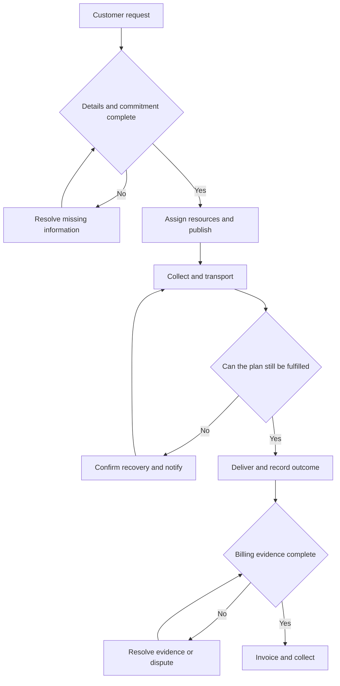

# Understanding Saudi Road Freight Operations

**A practical study guide for building freight software in Saudi Arabia**

A freight operator sells a promise: collect particular goods, deliver them under agreed conditions, and provide the evidence needed to charge for the work. Keeping that promise requires coordinating vehicles, drivers, cargo, facilities, documents and money.

For the dispatch product we are considering, the central question is:

> Given the work we have promised, which available resources should do it, in what order, and what should we change when reality disrupts the plan?

This guide starts with the wider logistics industry, then concentrates on domestic road freight and the work of a carrier's dispatch team. Read Sections 1–6 first, work through Sections 8–9 with a pen, and use the glossary and study plan afterward. The numerical examples are fictional teaching cases, not Saudi market rates or legally approved operating schedules. Saudi service references were checked on 10 October 2026; live operating requirements must come from the applicable current rules and contracts.

## 1 How logistics fits together

**Supply chain management** covers how a business sources, makes and supplies products. **Logistics** covers the movement, storage and handling needed along that chain. **Transport** is the movement between locations.

Imagine a Saudi distributor buying appliances from an overseas manufacturer. The goods may travel from the factory to an export port, cross the sea, clear customs, reach a Saudi warehouse by truck, and later go to retailers. A sale, a customs clearance and a truck trip are different activities, even when they concern the same goods.

Our current focus is the company operating those truck movements. It might carry its customers' goods between cities, replenish warehouses or move freight from a port. Its dispatch team decides how to deploy capacity.

Three flows run through every transport operation:

| Flow | What moves | Example |
| --- | --- | --- |
| Physical | Goods, vehicles and drivers | A loaded trailer travels from a warehouse to a customer |
| Information | Requests, commitments, instructions and evidence | An order gives a delivery window; a driver reports arrival |
| Financial | Prices, charges, costs, invoices and payments | The carrier pays for fuel, invoices the customer and later receives payment |

These flows do not finish together. Goods may be delivered while the proof of delivery is missing. The invoice may be issued while the customer disputes a waiting charge. A truck may complete its work before a subcontractor sends its bill.

As you learn, repeatedly ask: **What happened physically, what do we know about it, and what does it mean financially?**

## 2 Who is involved

The company paying for transport is not always the company sending or receiving the goods.

| Party | Its role | What matters to it |
| --- | --- | --- |
| Shipper or consignor | Sends the goods | Collection, correct handling and a reliable handover |
| Consignee or receiver | Receives the goods | Delivery timing, quantity, condition and receiving capacity |
| Freight payer | Pays the transport invoice under the agreement | Correct rates, approved charges and supporting documents |
| Carrier or haulier | Undertakes the road transport | Feasible work, reliable execution and profitable use of capacity |
| Subcontractor | Performs work assigned by another carrier or logistics provider | Clear instructions, agreed pay and prompt settlement |
| Freight broker or transport intermediary | Arranges capacity between customers and carriers | Carrier availability, commercial terms and service accountability |
| Freight forwarder | Organizes transport chains and related services, often across modes and borders | Coordination between carriers, documentation and trade requirements |
| Third party logistics provider or 3PL | Performs outsourced logistics, potentially including warehousing and transport | Performance of the broader customer operation |
| Customs broker | Handles authorized customs declaration and clearance work | Accurate trade documents and release of goods |

These are functional descriptions. One business can perform several roles; its legal responsibilities depend on its actual contracts and licences. FIATA's [explanation of freight forwarding](https://fiata.org/about-freight-forwarding/) is useful for understanding why a forwarder can coordinate a transport chain without physically operating every leg.

### Different kinds of fleet businesses

An **own-fleet carrier** operates vehicles it owns or leases. A **mixed-fleet carrier** uses its controlled vehicles and purchases additional capacity from partners. An **asset-light operator** relies primarily on contracted transport. A **private fleet** moves its parent company's own products.

For planning software, ownership alone is not the deciding factor. The useful question is **who can assign the vehicle, and for what period?**

A leased truck might be fully controlled by the dispatcher. A truck owned by the company might be committed to a dedicated customer for the entire week. A partner's quotation might offer a service without reserving any capacity.

### People inside the carrier

Sales agrees what the customer can buy. Order entry turns the request into an operational job. Dispatch assigns and sequences the work. Drivers execute it and report events. Fleet maintenance determines vehicle availability. Customer service communicates changes. Finance checks charges and documents, invoices customers and pays suppliers.

In a small business, one person may cover several of these jobs. The handovers still exist, even when they happen inside that person's head.

## 3 Freight segments have different workflows

“Logistics software” is too broad a category to understand a customer's daily work. First identify the operating pattern.

| Segment | How the freight moves | Main planning difficulty |
| --- | --- | --- |
| Full truckload or FTL | A vehicle or trailer is dedicated to a customer's load | Matching equipment and drivers, sequencing trips and positioning for later work |
| Less than truckload or LTL | Several customers share capacity | Consolidation, collection and delivery routes, transfer timing and capacity |
| Local distribution | One vehicle makes multiple deliveries or collections | Stop order, access, unloading time and customer windows |
| Container haulage or drayage | Containers move between ports, depots and inland sites | Releases, appointments, chassis, container identity and empty returns |
| Refrigerated transport | Cargo travels under specified temperature conditions | Equipment, temperature evidence, compatibility and handling |
| Bulk or tanker transport | Loose material or liquid moves in specialist equipment | Payload, product compatibility, cleaning and unloading facilities |
| Heavy or abnormal loads | Oversized or unusually heavy cargo moves on specialist equipment | Route suitability, permits, escorts and engineering constraints |

FTL does **not** mean every cubic metre is occupied. A customer may reserve the entire vehicle for urgency, security or handling reasons. LTL does not always mean a terminal network; some operators combine part loads directly. Learn the particular company's service design. DHL's [road-freight services](https://www.dhl.com/se-en/home/freight/european-road-freight.html) illustrate the distinction between groupage networks, direct transport and specialist services.

### Why LTL becomes a different planning problem

A two-pallet shipment could be collected by a local truck, transferred to an origin terminal, carried with other customers' goods on an intercity truck, and delivered by another local truck.

The customer bought one transport service. Internally, the operator performed several **legs**. Many shipments can share one leg, and one shipment can use several vehicles.

A **cross-dock** transfers freight between incoming and outgoing transport with limited storage. A **warehouse** primarily stores and manages inventory. Both can exist at the same site, but their operational purposes differ.

The initial product in our PRD concentrates on dedicated jobs with one pickup and one delivery, followed by other jobs on the same resources. That gives you a clear first workflow to master before adding consolidation and terminal connections.

## 4 The things dispatchers actually schedule

### A truck can represent several separate resources

A **rigid truck** has its cargo body attached to the vehicle. An articulated combination usually includes a **tractor unit**, a **semi-trailer** and a **driver**.

The tractor might be mechanically available while its trailer is still being unloaded. The trailer might be ready while the driver is resting. A replacement driver cannot take over unless they can physically reach the vehicle and are eligible to operate it.

A fleet count of 100 vehicles therefore does not mean 100 interchangeable resources available now.

For each resource, ask:

- Where is it, and how recently was that location confirmed?
- What is it doing, and when is it expected to be released?
- What cargo, equipment or customer restrictions apply?
- What future work is already committed?
- What maintenance, working-time or access constraints apply?

**Availability has a location, a time and a set of conditions.** It is rarely a simple yes or no.

### Cargo uses several kinds of capacity

Weight, volume, floor space and handling requirements are separate constraints.

Dense cargo can exhaust the permitted payload while leaving room in the trailer. Light bulky cargo can fill the body while using little payload. Non-stackable pallets consume more usable floor space than their volume suggests. Cargo may fit geometrically but have unacceptable weight distribution or require loading equipment the site lacks.

Useful units include kilograms or tonnes, cubic metres, pallet positions and **loading metres**, a measure of occupied trailer floor length. A pallet is a handling unit, not a universal size or weight. Actual dimensions and stackability matter.

### Locations are operating sites

“Riyadh” is not a sufficient pickup address. A job may need a particular warehouse gate, entry route, contact, appointment, loading bay and security approval.

A site's opening hours differ from an appointment. “We receive from 08:00 to 17:00” does not mean every truck can arrive at any moment and be unloaded immediately.

### Lane and network

A **lane** is an origin-to-destination flow, such as Dammam to Riyadh. The reverse direction is a separate commercial market: demand and available trucks can differ.

A **depot** is an operating base. A **hub** concentrates flows for onward movement. **Linehaul** generally refers to the longer movement between hubs, terminals or major locations.

Where a truck ends today affects the work it can perform tomorrow. This is why planning one shipment independently can produce a poor fleet plan.

## 5 One shipment from request to payment

Consider a fictional distributor asking a carrier to move a dedicated load of packaged goods from a Dammam warehouse to a Riyadh warehouse.

### Step 1 Understand the request

The customer supplies some combination of locations, cargo details, collection date and delivery requirement. Requests can arrive through a portal, system integration, spreadsheet, email or a conversation.

The order-entry person must establish what is missing. Does “tomorrow morning” refer to pickup or delivery? Is the cargo ready? Does the destination unload the vehicle? Is the weight total cargo weight or weight per pallet? Is a particular trailer required?

A record can exist before it is safe to plan. “Captured” and “operationally ready” should mean different things.

### Step 2 Agree price and service

The carrier uses a negotiated rate agreement or prepares a spot quote for this request. The commercial agreement should establish the base service, what is included, extra charges and payment terms.

A quote does not necessarily become a confirmed job. Acceptance, capacity confirmation and any required customer authorization are separate events.

A transport **tender** can mean a request to a carrier to accept an individual shipment. In another context it means bidding for a longer contract. Always establish which meaning is intended.

### Step 3 Check the job before planning

Operations confirms addresses, time windows, equipment, cargo readiness and relevant documents. Credit control may have a separate role if the customer is on hold.

A pickup window might mean the time to arrive at the gate, start loading or finish loading. These are different constraints. A usable order states which event the customer expects.

### Step 4 Assign resources and sequence the work

The dispatcher chooses the vehicle, trailer and driver, or books an approved subcontractor. They consider the empty journey to pickup, loading, travel, unloading, driver availability and the next commitment.

The nearest truck may be wrong because it is unsuitable, still busy or needed for work that other trucks cannot do. The dispatcher is coordinating the day's work as a whole.

### Step 5 Publish and acknowledge instructions

A plan in the office is a proposal until the execution team receives it. Drivers need the correct address, contact, times, cargo instructions and required references.

A sent instruction is not proof that the driver has understood and accepted it. Changes must reach the right person; superseded instructions must not remain ambiguous.

### Step 6 Collect the goods

The truck travels to the site, checks in, waits if necessary, loads and departs. The driver or loading team records the relevant quantity, condition, references and exceptions.

Keep arrival, loading start, loading completion and departure distinct. A two-hour delay could come from a gate queue, unavailable cargo or loading itself. Those causes suggest different improvements.

### Step 7 Monitor and respond

Travel may encounter traffic, access restrictions, breakdowns or changes at the destination. The dispatcher updates the expected arrival and checks downstream work.

An **ETA**, or estimated time of arrival, is a prediction. It is not the same as the promised delivery window or the actual arrival event.

### Step 8 Deliver and establish the outcome

The destination receives the goods, checks quantity and condition, and records acceptance or exceptions. A partial delivery, damage or refusal requires a different follow-up from a clean delivery.

**Proof of delivery**, or POD, may include a signed document, electronic signature, quantities, timestamps, photographs or a receiver reference. The customer's agreed evidence requirements determine what is sufficient.

### Step 9 Prepare the commercial closeout

Finance checks the agreed price, additional services, evidence of waiting or other charges, and required references. The carrier may also need to match a subcontractor's bill to the performed work.

Delivered work can remain unbilled because evidence or approval is missing. Conversely, some commercial arrangements bill in advance or periodically. The example here follows a common post-delivery workflow, not a universal invoicing rule.

### Step 10 Invoice and collect

The transport invoice enters the customer's approval and payment process. Disputes, credits, partial payments and reconciliation can follow.

Operational completion, invoice readiness, invoice issuance and payment are separate milestones. Opter's [order-status documentation](https://docs.opter.com/en/order-reception-022.htm) illustrates this distinction by separating dispatch readiness, invoicing readiness and execution status.

## 6 What a dispatcher does during the day

The dispatcher manages a changing set of commitments. Routing is one part of that job.

At the start of a shift, they reconcile overnight events: which trips finished, which trucks remain at customers, which drivers are available, what broke down and what new orders arrived. They then cover imminent pickups and identify the jobs that have few feasible options.

As the shift progresses, the dispatcher deals with new information. A customer postpones collection. A vehicle becomes free earlier than expected. A partner fails to confirm. A delivery takes longer than planned. Each event can change several later assignments.

Toward the end of the shift, the team prepares the next handover: outstanding work, uncertain release times, instructions already sent and customers needing attention.

Four distinctions help you understand the work:

| Distinction | Why it matters |
| --- | --- |
| Hard constraint versus preference | A vehicle cannot exceed applicable limits; a preference for a particular driver may be negotiable |
| Confirmed versus tentative | A booked partner truck can support a plan; an unanswered enquiry cannot |
| Planned versus actual | The schedule says unloading ends at 14:00; a confirmed departure tells you what happened |
| Local versus wider consequence | Saving a short empty movement now may prevent a much better assignment later |

When a dispatcher overrides software, investigate the reason. They may know a constraint that the system lacks, distrust stale data, protect a customer commitment or make an avoidable habit-based choice. The override itself does not tell you which explanation is correct.

## 7 The documents and what they prove

Documents connect physical events to commercial and regulatory responsibilities. Similar names can hide very different purposes.

| Document or record | What it describes | What it does not establish by itself |
| --- | --- | --- |
| Customer transport request | The service the customer wants | That the carrier accepted it |
| Quote or rate agreement | Commercial terms and service scope | That a vehicle is reserved |
| Purchase order or PO | Customer authorization to purchase | That the goods have been delivered |
| Goods commercial invoice | The sale and value of the goods | The carrier's transport charge |
| Packing list | Packages, contents, quantities and relevant measurements | A confirmed vehicle assignment |
| Transport order or job | The operator's record of work to perform | That dispatch instructions reached the driver |
| Road consignment note or transport document | Parties, goods and details of the carriage | That payment has been received |
| Manifest or load list | Goods or shipments included in a movement | Acceptance of every item at destination |
| Delivery note | Goods presented for delivery | Accepted delivery unless the required acknowledgement is recorded |
| POD | Evidence of the delivery outcome | Automatic approval of every charge |
| Freight invoice | Charges for transport and related services | Receipt of payment |
| Subcontractor bill or settlement | Amount due to a transport supplier | That the customer's invoice has been paid |

Terminology varies. “Delivery order” in a port context can authorize release of cargo; it is not automatically the same as a warehouse delivery note. “Bill of lading” is common in sea freight and some other markets, but you should not impose its legal meaning on every Saudi domestic road document. In Saudi road workflows, learn the relevant **وثيقة النقل** and **بيان الحمولة** separately from the customs declaration.

For any document, ask who creates it, who must accept it, which job it refers to and what process it unlocks.

A missing PO number might block customer invoice approval without stopping the truck. Missing release authorization might stop collection entirely. A damaged-goods note might allow physical delivery while opening a claim. These are different exceptions.

## 8 How a transport company makes money

### Revenue has a service basis

A carrier may charge per trip, per pallet, per tonne, per kilometre, per vehicle-day or through a dedicated-capacity contract. A rate can also depend on lane, equipment, urgency and service conditions.

**Spot pricing** covers individual or short-term requests. **Contract pricing** applies agreed rates or formulas over a period. A rate agreement does not necessarily guarantee volume, and a demand forecast does not necessarily guarantee payment.

Extra charges, often called **accessorials**, can cover waiting, additional stops, special handling or other agreed services. A delay is not automatically billable. The agreement, evidence, approval process and actual collection matter.

### Understand three different cost questions

**Incremental cost:** What extra cost does this decision cause? This is useful when deciding whether to accept work or use a different assignment.

**Allocated full cost:** What share of the business's costs should this work carry? This helps evaluate longer-term pricing and profitability.

**Cash timing:** When must the business pay, and when will it collect? This determines whether it can fund operations.

Fuel and outsourced transport often vary directly with work. Tyre and maintenance wear may be estimated per kilometre, even though the invoice comes later. Salary, vehicle finance, insurance and office costs may continue when a truck is idle. Overtime or additional vehicle rental can change that picture.

A dispatcher saving a journey can reduce fuel and wear. That does not immediately eliminate the vehicle's lease payment. **Contribution toward fixed costs is not the same as net profit.**

### Worked example of a return load

Assume a fictional outbound trip is 450 km. The vehicle must eventually return to its starting base. All figures below exclude tax and are teaching assumptions.

The outbound customer pays SAR 2,600. Estimated distance-related cost is SAR 1.40 per km, including fuel and an allowance for distance-related wear. A trip allowance costs SAR 250.

A confirmed return load would pay SAR 1,500. Its pickup and final positioning add 40 km of empty movement. It also adds SAR 80 of incremental time-related cost. Both plans fit the same available resource period.

| Item | Outbound then empty return | Outbound plus confirmed return load |
| --- | ---: | ---: |
| Loaded distance | 450 km | 900 km |
| Empty distance | 450 km | 40 km |
| Total distance | 900 km | 940 km |
| Revenue | SAR 2,600 | SAR 4,100 |
| Distance-related cost | SAR 1,260 | SAR 1,316 |
| Trip allowance | SAR 250 | SAR 250 |
| Additional time-related cost | SAR 0 | SAR 80 |
| Contribution before fixed costs | **SAR 1,090** | **SAR 2,454** |

The return load increases contribution by **SAR 1,364**:

`SAR 1,500 extra revenue − SAR 56 extra distance cost − SAR 80 extra time cost.`

Notice that the better plan drives **more** total kilometres. Its advantage comes from earning money on a movement the vehicle otherwise makes empty.

Now change the situation. Suppose the return load would prevent another feasible job contributing SAR 1,400. Its apparent SAR 1,364 improvement becomes a SAR 36 disadvantage compared with that alternative, assuming other effects are equal. This is **opportunity cost**.

A possible return load is also different from a confirmed one. A dispatcher might decide to wait for work, but its revenue remains uncertain. A forecast can inform that decision; it must not silently become guaranteed income.

### Own fleet versus subcontractor

Suppose the same outbound customer pays SAR 2,600 and an approved partner offers the whole service for SAR 1,800. That leaves SAR 800 before the operator's remaining overhead and risks.

The owned-fleet option above contributes SAR 1,090, including its empty return. On those assumptions, using the owned vehicle is better by SAR 290.

But subcontracting might release the owned vehicle for another feasible job contributing SAR 500. The combined contribution would then be SAR 1,300. The comparison changes because you considered the work of the fleet together.

Check the full service scope, resource timeline, endpoint, partner availability, expected reliability and any retained costs before applying this logic. A cheap unconfirmed quote is not equivalent to secured capacity.

### Profit and cash can diverge

A profitable job can still create a cash gap. Fuel and some supplier charges may be paid before the customer pays its invoice. Missing documents can extend that gap.

This explains why a carrier can care about faster POD collection and billing even when those features do not reduce driving distance. It also explains why reducing accounting costs on a dashboard is different from improving cash in the bank.

## 9 A dispatch exercise with two trucks and three jobs

This miniature example uses fictional sites A, B and C. It illustrates resource assignment rather than Saudi journey times or driver-hour rules. Assume the drivers and vehicles are eligible for the stated work, and that each truck represents a confirmed vehicle and driver team.

### Resources and confirmed jobs

| Resource | Ready at site A | Capability |
| --- | --- | --- |
| Truck 1 | 08:00 | Box body; rear loading only |
| Truck 2 | 09:30 | Curtain-side body; suitable for rear or side loading |

| Job | Movement | Pickup loading must start | Handling and travel |
| --- | --- | --- | --- |
| J1 | A to B | 08:00–10:00 | Either truck; 30 min loading, 60 min travel, 30 min unloading; finish delivery by 12:00 |
| J2 | A to C | 10:00 exactly | Side loading required; 30 min loading, 45 min travel, 30 min unloading; finish by 12:00 |
| J3 | B to A | 10:30–11:00 | Either truck; 30 min loading, 60 min travel, 30 min unloading; finish by 13:00 |

Treat these as planning estimates for the exercise. Loading and unloading sites at B are assumed to be the same facility, with no transfer travel. No cargo is shared between jobs.

### Build the plan

J2 can only use Truck 2. Protect that assignment first.

Truck 1 can perform J1 early, be available at B, and then take J3 back to A.

| Resource | Activity | Time |
| --- | --- | --- |
| Truck 1 | Load J1 at A | 08:00–08:30 |
| Truck 1 | Travel to B | 08:30–09:30 |
| Truck 1 | Unload J1 | 09:30–10:00 |
| Truck 1 | Available buffer at B | 10:00–10:30 |
| Truck 1 | Load J3 at B | 10:30–11:00 |
| Truck 1 | Travel to A | 11:00–12:00 |
| Truck 1 | Unload J3 | 12:00–12:30 |
| Truck 2 | Load J2 at A | 10:00–10:30 |
| Truck 2 | Travel to C | 10:30–11:15 |
| Truck 2 | Unload J2 | 11:15–11:45 |

Assigning Truck 2 to J1 at 09:30 is individually feasible: it finishes delivery at 11:30. But that leaves nobody able to perform J2 at 10:00. A sequence of individually reasonable decisions can produce an infeasible overall plan.

The exercise also shows why completion times matter. Truck 1 arrives at B at 09:30 but becomes free at 10:00. Omitting unloading would exaggerate its availability.

### Introduce a disruption

At 09:45, site B says J1 unloading will now finish at 12:00. J3's latest permitted loading start is 11:00. Truck 1 can no longer perform J3 under the agreed window.

Truck 2 is committed to J2. Even if it finishes J2 as planned at 11:45, it is already too late for J3 before accounting for any travel to B.

Reasonable recovery options include obtaining confirmed suitable partner capacity for J3, negotiating a changed pickup window with the customer, or reviewing a broader set of unstarted assignments if genuinely movable capacity exists.

The dispatcher must record the approved recovery and communicate it. Changing a time in the system does not change the customer's agreement.

### What this teaches

The dispatch problem combines **eligibility**, **timing**, **sequencing**, **uncertainty** and **commercial consequences**. The map is only one input.

A useful system should be able to explain: “Truck 2 is reserved for J2 because Truck 1 cannot load that cargo. J3 became infeasible because Truck 1's release at B moved beyond the pickup window.”

## 10 Why plans fail in ordinary operations

| Event | Immediate effect | Wider consequence |
| --- | --- | --- |
| Cargo is not ready | Loading cannot start | Later delivery and return work may become infeasible |
| Receiver has no unloading capacity | Truck waits | Vehicle, trailer and driver may remain occupied |
| Quantity differs from the order | Capacity or handling changes | Another vehicle, price revision or customer approval may be needed |
| Vehicle breaks down | Resource becomes unavailable | Recovery requires a real replacement and possibly cargo transfer |
| Driver cannot continue | Vehicle may be usable but the team is not | Relief requires eligibility, travel and a handover |
| Partner does not confirm | Purchased capacity remains uncertain | The operator must secure an alternative before relying on it |
| Site rejects goods | Delivery is incomplete | Storage, return instructions, claims and billing need attention |
| POD is missing | Delivery evidence is incomplete | Customer approval or invoicing can be delayed |
| New urgent job arrives | New demand competes for capacity | Accepting it may displace more valuable committed work |

A recovery action has its own workflow. Moving cargo between trucks needs a location, labour, time, equipment and authorization where required. Swapping trailers requires compatible equipment and physical access. An optimizer cannot solve those problems merely by changing resource IDs.

Some delay is recoverable inside a buffer. Other delay destroys the next connection. This is why average transit time alone is not enough: the consequences depend on the remaining schedule.

Also distinguish **exception detection** from **exception resolution**. Knowing a truck is late is useful. Knowing who must act, which options remain feasible and whether the customer approved the change makes that information operational.

## 11 Where the operational information lives

A logistics company can have several systems and still rely heavily on human coordination between them.

| System | Main purpose | Typical information |
| --- | --- | --- |
| Transport management system or TMS | Organize transport work | Jobs, assignments, statuses, rates and transport billing |
| Enterprise resource planning system or ERP | Manage business transactions and accounts | Customers, sales, purchasing, invoices and accounting |
| Warehouse management system or WMS | Manage goods inside a warehouse | Inventory, picking, staging, loading and receiving |
| Telematics or fleet tracking | Report vehicle observations | Positions, trips and available vehicle sensor data |
| Maintenance system | Manage equipment condition and service | Defects, repairs, inspections and availability |
| Driver application | Communicate assigned work and capture events | Acknowledgements, arrival, loading, delivery and POD |
| Customer or supplier portal | Exchange information with another organization | Bookings, status, approvals and documents |
| Email, chat and spreadsheets | Handle flexible communication and local coordination | Requests, exceptions, explanations and working plans |

A TMS may include several of these functions; another company may use separate products. **EDI**, or electronic data interchange, means structured business information exchanged between organizations. It is a communication approach, not one universal logistics database.

Opter's [feature overview](https://opter.com/funktioner-och-teknik/) shows how broad a transport system can become: intake, assignment, multi-leg work, driver communication, POD, pricing, invoicing and supplier settlement. Its own feature list also includes AI-assisted intake and route optimization. This is useful context when judging what a new product must improve.

### Order, shipment, leg, trip and stop

These words are often used inconsistently across systems. Agree their meanings before importing data.

For learning, use these working definitions:

- **Order:** the customer's commercial request for transport.
- **Shipment or consignment:** the identified goods being transported together under a particular movement arrangement.
- **Leg:** one portion of that movement, such as terminal to terminal.
- **Trip or vehicle run:** a vehicle's planned movement, potentially carrying several shipments or performing sequential jobs.
- **Stop:** a location visit with an activity, such as pickup, delivery or handover.

In a simple FTL operation, one order may map to one shipment and one loaded leg. In a network operation, that relationship becomes many-to-many. A vehicle's empty repositioning can also matter even when no customer shipment is aboard.

### Observations are not the complete operational truth

A GPS point establishes where a device was observed. It does not prove that unloading finished, the driver is available or the customer accepted delivery.

A driver pressing “delivered” is a reported event. Finance may still need evidence or a discrepancy resolved. A customer's email can revise the delivery window without immediately updating the TMS.

For important information, preserve both **when the event happened** and **when the business learned about it**. If a release was recorded at 14:00 but only reported at 15:30, a planning decision made at 14:30 could not have used that knowledge.

For an ML engineer, this is a familiar distinction between the real process and its imperfect observations. It also creates a common evaluation error: comparing a historical dispatcher with an algorithm that has access to information received later.

## 12 Saudi context to understand

The physical and commercial principles above travel across countries. Saudi operations add particular institutions, operating conditions and customer requirements.

### Know the purpose of each platform

| Name | What to understand first |
| --- | --- |
| TGA and its transport service channels | The Transport General Authority governs relevant transport activities; licensing and operating permissions are distinct from daily dispatch |
| Naql and Logisti | Names you will encounter around transport services and administration; verify the current service route for the activity concerned |
| Bayan | Road-freight transport documents and truck manifests, as described by its operator |
| Wasl | Regulatory connectivity and monitoring of relevant land-transport activities; this is distinct from deciding which customer job a truck should perform |
| Fasah | A trade single window supporting import, export and customs-related processes |
| Saber | Product conformity processes within the relevant Saudi standards and technical-regulation scope |
| ZATCA Fatoora | Electronic invoicing requirements and processes |

Elm's [transport products page](https://elm.sa/ar/our-business/digital-products/Pages/transportation-products.aspx) describes Logisti, Wasl and Bayan. Its [Bayan product guide](https://elm.sa/ar/our-business/digital-products/Documents/Ar/Bayan.pdf) connects Bayan registration with Naql. These are service descriptions, not a complete statement of which obligation applies to a particular operator.

[Fasah's services](https://www.fasah.sa/trade/home/en/services.html?service_id=0), [SASO's product conformity service](https://www.saso.gov.sa/en/eservices/pages/details.aspx?serviceid=396) and [ZATCA's e-invoicing overview](https://zatca.gov.sa/en/E-Invoicing/Pages/default.aspx) explain three different kinds of work. A customs clearance, a product conformity certificate and a transport invoice are not interchangeable documents.

For a domestic dispatch product, learn which outputs or statuses an operator already obtains from these services. The existence of an official system does not establish that you need to replace it or integrate with it in the first learning exercise.

### Access and calendars affect feasibility

Truck access can depend on city, route, time, vehicle category and permission. TGA's [Riyadh service announcement through the Saudi Press Agency](https://www.spa.gov.sa/w1840779) describes scheduled entry during restricted periods. Treat that as evidence that access must be modeled, not as a current timetable for every city.

Loading and receiving calendars can also differ by customer, site and season. Ask for the real calendar and its exceptions. Do not assume the same Friday schedule, Ramadan hours or appointment policy across all customers.

The same discipline applies to permitted weights, driver working and rest rules, dangerous goods and specialist transport: determine the applicable operation and current requirements before setting a constraint. European or US defaults are not Saudi rules.

### Language and addresses require operational precision

You may encounter Arabic and English names for the same customer or site, different transliterations, coordinates and informal site descriptions. “Warehouse 2” only makes sense within a particular organization.

The useful data record joins the customer identity, physical gate, coordinates, access instructions and contact. Language support helps people use that record, but translation alone does not resolve an ambiguous destination.

### Port and cross-border work add dependencies

A container physically arriving at port does not necessarily make it ready for truck collection. Customs release, shipping-line release, terminal availability and appointments may be separate dependencies.

The empty container's return is another task with an agreed destination and timing. Container demurrage and detention commonly relate to time inside and outside the terminal beyond agreed free time; actual tariff definitions and combined arrangements vary. They are distinct from a trucker's waiting charge. See [Maersk's explanation](https://www.maersk.com/it-it/logistics-explained/transportation-and-freight/2023/08/28/what-is-demurrage-detention-in-shipping-for-buyers/).

Cross-border road movements add country-specific permissions, border procedures and uncertain clearance time. Learn domestic dispatch first, then study these dependencies as a separate operating pattern.

### Learn what Incoterms actually answer

When goods are traded, Incoterms can allocate responsibilities, costs and the point of risk transfer between buyer and seller. They do not by themselves establish ownership transfer or replace the carrier's transport contract.

The practical question is who must arrange and pay for transport, from which point, under the sale agreement. You do not need to memorize all eleven rules before understanding a dispatcher's day. Use [ICC's explanation of Incoterms and commercial contracts](https://library.iccwbo.org/clp/clp-incoterms-qa-2020.htm?AGENT=ICC_FIN) when studying international freight.

## 13 The metrics operators care about

A metric is only useful when the event, period and denominator are clear.

| Metric | Working definition | Interpretation to watch |
| --- | --- | --- |
| On-time pickup or delivery | Eligible jobs meeting the agreed event and window ÷ eligible jobs | Arrival and completion can give different results; preserve the original promise and approved revisions |
| Empty distance share | Empty km ÷ total km over a defined resource set and period | Low empty distance is not valuable if the work loses money or breaks commitments |
| Payload utilization | Cargo weight ÷ usable permitted payload for the relevant leg | This says little about volume or floor-space use |
| Time utilization | Time in a defined useful activity ÷ defined available time | Driving, loaded time and paid time are different definitions |
| Dwell time | Departure minus arrival at a site | Separate queueing, loading and unloading to find the cause |
| Contribution per truck-day | Defined contribution ÷ included truck-days | State which costs and idle days are included |
| Outsourcing spend | Cost of purchased transport in the period | It can rise for good reasons if it enables profitable extra work |
| POD turnaround | Required evidence received minus delivery time | Missing evidence should not disappear from the report |
| Delivery-to-invoice time | Invoice issuance minus delivery time for the defined cohort | Track unbilled jobs separately to avoid hiding the worst delays |
| Plan change rate | Defined changes after publication ÷ defined published assignments | Some changes prevent failure; fewer changes is not automatically better |
| ETA error | Difference between predicted and actual arrival | Compare predictions made at the same lead time |

There is no single perfect utilization number. A full truck waiting all day may have excellent payload utilization and poor productive use of time. A vehicle deliberately held for a guaranteed urgent service may look idle while fulfilling a valuable contract.

When evaluating software, compare plans using the same known orders, constraints, starting resources and information available at the decision time. Otherwise the claimed improvement can come from an easier scenario rather than a better decision.

## 14 How to connect the domain to software opportunities

Treat every software idea as a proposed improvement to a specific decision or handover.

| Operational problem | Possible software help | What you must establish |
| --- | --- | --- |
| Requests are incomplete or repeatedly entered | Capture and review structured orders | The actual formats, missing fields and current correction work |
| Resource availability is scattered | Shared operational view | Who maintains it and how quickly changes arrive |
| Assignments overlook downstream effects | Feasible planning and comparison | Whether meaningful alternatives exist and the dispatcher controls them |
| Delays trigger many manual checks | Impact analysis and recovery options | Which commitments can move and who approves changes |
| Extra charges lack evidence | Event and document capture | Whether the charges are contractually billable and collectible |
| Delivered work remains unbilled | Readiness checks and exception queues | The real reasons finance cannot invoice |

A company with fixed routes and fixed customers may have limited assignment freedom but substantial documentation pain. A mixed carrier with volatile jobs and flexible resources may have more planning opportunity.

Before calling something an optimization problem, ask: **Which decisions can this customer actually change?** If everything is fixed by contracts, the more useful product might improve visibility, exception handling or commercial administration.

For our planned product, your first domain milestone is to explain why one feasible dispatch plan is better than another and why the operator might reject both. That understanding determines which data and rules the software must represent.

## 15 English and Arabic vocabulary

These are practical learning equivalents, not authoritative translations of legal terms. Operators may use different local wording.

| English | Arabic you may encounter | Meaning |
| --- | --- | --- |
| Carrier or haulier | ناقل / شركة نقليات | Business undertaking transport |
| Shipper or consignor | المرسِل / الشاحن | Party sending the goods |
| Consignee | المرسَل إليه | Party receiving the goods |
| Freight broker | وسيط شحن / وسيط نقل | Intermediary arranging transport |
| Dispatcher | مسؤول الحركة / منسق النقل | Person coordinating transport assignments |
| Fleet | أسطول | Group of vehicles under an operation |
| Tractor unit | قاطرة / رأس شاحنة | Powered unit pulling a trailer |
| Trailer | مقطورة | Cargo-carrying unit towed by a vehicle |
| Pickup | استلام / تحميل | Collection; clarify whether the event is arrival or loading |
| Delivery | تسليم | Handover at destination |
| Loading and unloading | تحميل وتفريغ | Putting goods onto and removing them from transport |
| Shipment | شحنة | Identified goods being moved |
| Load | حمولة | Cargo carried, or a job in informal speech |
| Trip | رحلة | A defined vehicle movement or run |
| FTL | حمولة شاحنة كاملة | Dedicated full-truckload service |
| LTL | شحن جزئي / حمولة جزئية | Shared-capacity service |
| Empty running | سير فارغ / رحلة فارغة | Movement without cargo |
| Backhaul or return load | حمولة عودة | Revenue work on a return or repositioning flow |
| Time window | نافذة زمنية / فترة مسموحة | Agreed interval for a defined event |
| ETA | وقت الوصول المتوقع | Predicted arrival time |
| POD | إثبات التسليم | Evidence of the delivery outcome |
| Transport document | وثيقة النقل | Record associated with the carriage |
| Manifest | بيان الحمولة | List of cargo in a movement |
| Customs declaration | بيان جمركي | Customs record; distinct from the truck manifest |
| Subcontractor | ناقل متعاقد / مقاول من الباطن | Supplier performing assigned work |
| Waiting charge | رسوم انتظار | Agreed charge linked to qualifying waiting |
| Freight charges | أجور النقل | Payment for the transport service |

## 16 A practical two week study plan

You can do the initial learning from documents, demonstrations and exercises. Later, anonymized operating records and asynchronous explanations from operators will help distinguish your assumptions from their actual process.

| Session | Study task | What to produce |
| --- | --- | --- |
| 1 | Read Sections 1–3 | Explain a carrier, forwarder and 3PL without using their names as definitions |
| 2 | Draw one customer's shipment chain | Identify goods, information and money at each handover |
| 3 | Study vehicles, drivers, sites and cargo | A resource sheet showing location, ready time and eligibility |
| 4 | Read the request-to-payment workflow | A job record with separate operational and financial milestones |
| 5 | Examine document purposes | Explain what five different documents prove and what they do not |
| 6 | Recalculate the return-load example | A cost comparison with explicit assumptions |
| 7 | Solve the two-truck exercise without the answer | A feasible schedule including handling time |
| 8 | Add the unloading delay | A recovery plan with the approvals it requires |
| 9 | Explore Opter's order and dispatch documentation | Map visible fields to operational decisions rather than copying screens |
| 10 | Read the Saudi platform descriptions | Explain the difference between Bayan, Fasah and Fatoora |
| 11 | Create ten fictional jobs and five resources | A small planning board with incompatible jobs and missing information |
| 12 | Define five metrics on your dataset | State denominators, timestamps and missing-data handling |
| 13 | Compare FTL with an LTL network | Identify the extra legs, handling and shared-capacity decisions |
| 14 | Explain a carrier's day aloud | Describe why a feasible plan can still be commercially unattractive |

### Useful evidence to study next

When an operator is willing to share material, ask for a small anonymized example: an incoming request, a dispatch sheet, the relevant rate agreement, one exception, a POD and the resulting invoice. A short recorded walkthrough or written explanation can accompany it.

Use the same job across the documents. That lets you reconstruct the actual handovers rather than collect disconnected screenshots. Customer names, driver identities and commercially sensitive fields can be removed when unnecessary.

Questions worth answering from those examples:

- Who can accept a job or change its promised time?
- When is the cargo genuinely ready?
- Who updates a truck's expected release?
- What makes a particular vehicle or driver unsuitable?
- What does the dispatcher know that the system does not?
- When is partner capacity considered confirmed?
- Which changes require customer approval?
- What blocks invoicing after delivery?
- How does the company define a profitable trip?
- Which decisions are fixed, and which are still open?

Public research can teach you the workflow and help build credible exercises. It cannot establish a particular company's error rates, recoverable savings or willingness to pay. Those require evidence from that operation.

### Check your understanding

Try answering before reading the explanations.

1. **A truck is at the customer's warehouse. Can you assign its next job?** Only after establishing its release time, equipment and driver availability, and the travel needed to the next pickup.
2. **A truck is only half full. Was the plan wasteful?** Not necessarily. The service may be dedicated, or the binding constraint may be weight, handling, urgency or compatibility.
3. **A return load pays less than the outbound load. Should it be rejected?** Compare incremental contribution, time, endpoint and displaced alternatives.
4. **The shipment is delivered. Can the carrier invoice?** Check the agreement, required evidence, references, charges and any unresolved exception.
5. **An algorithm reduces distance by 10 percent. Is that a business improvement?** Only after confirming equivalent service, feasibility, real cost impact and no harmful displacement of later work.
6. **The driver disagrees with the plan. Is the plan wrong?** Investigate the missing fact or misunderstanding; neither party's confidence establishes feasibility.

## 17 Further reading

Use these sources for specific questions. Supplier documentation describes that supplier's workflow; it is not a universal operating standard.

| Source | Read it to understand |
| --- | --- |
| [FIATA on freight forwarding](https://fiata.org/about-freight-forwarding/) | The forwarder's role across the transport chain |
| [DHL road freight](https://www.dhl.com/se-en/home/freight/european-road-freight.html) | Groupage, direct transport and specialist service categories |
| [Opter features](https://opter.com/funktioner-och-teknik/) | The breadth of a transport management system |
| [Opter order status](https://docs.opter.com/en/order-reception-022.htm) | Separate execution, dispatch and financial readiness |
| [Elm transport products](https://elm.sa/ar/our-business/digital-products/Pages/transportation-products.aspx) | Saudi transport service infrastructure |
| [Elm Bayan guide](https://elm.sa/ar/our-business/digital-products/Documents/Ar/Bayan.pdf) | Road transport documents and manifests |
| [TGA Bayan user guide](https://bayan.tga.gov.sa/assets/files/user_guide_ar.pdf) | An Arabic walkthrough of the transport-document workflow |
| [Saudi Press Agency on truck entry](https://www.spa.gov.sa/w1840779) | Why city access and booking requirements matter |
| [Fasah services](https://www.fasah.sa/trade/home/en/services.html?service_id=0) | Trade and clearance roles |
| [SASO conformity service](https://www.saso.gov.sa/en/eservices/pages/details.aspx?serviceid=396) | Product conformity work through Saber |
| [ZATCA e-invoicing](https://zatca.gov.sa/en/E-Invoicing/Pages/default.aspx) | The distinction between a freight bill and compliant invoice processing |
| [ICC on Incoterms and contracts](https://library.iccwbo.org/clp/clp-incoterms-qa-2020.htm?AGENT=ICC_FIN) | Buyer and seller obligations, risk and costs |
| [Maersk on container time charges](https://www.maersk.com/it-it/logistics-explained/transportation-and-freight/2023/08/28/what-is-demurrage-detention-in-shipping-for-buyers/) | Container free time, demurrage and detention |

Keep a learning notebook with four columns: **term or situation**, **what I think it means**, **an operational example**, and **what would verify it**. Use it to turn each unfamiliar field or exception into a concrete question about the business.

