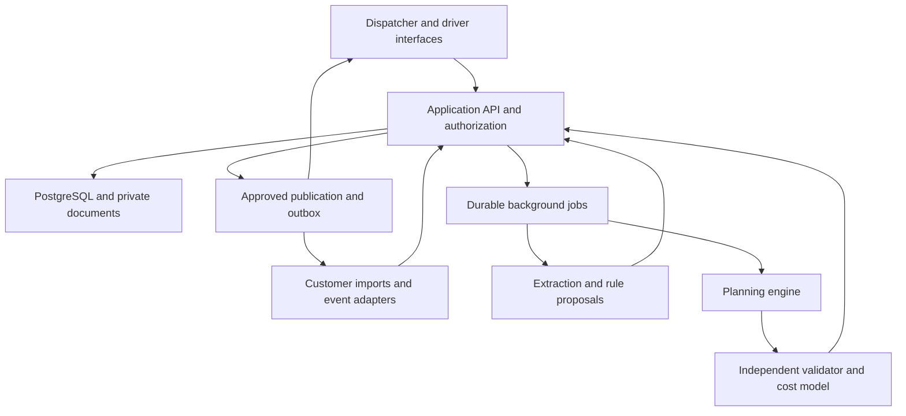

# Saudi Freight Dispatch Product Requirements

**Version:** 1.1  
**Date:** 10 October 2026  
**Status:** Staged build specification: first planning loop, shadow pilot, then supervised live dispatch. Commercial demand and pilot economics remain hypotheses.  
**Audience:** Founder, AI coding agents, product engineers and optimization engineers.  
**Working product name:** Saudi Freight Dispatch. This is a descriptive working name, not an approved brand.

Build a bilingual dispatch-planning product for Saudi road-freight operators. It must turn confirmed transport jobs and real resource availability into feasible, financially explained plans; let dispatchers revise those plans using operational rules; and carry approved assignments through execution and evaluation.

The first customer should be able to use it for a real depot workflow. A demonstration with synthetic data is an implementation milestone, not proof of market fit or readiness for live dispatch.

**Implementation decisions:** The backend, domain logic, workers and optimization are Python. All language-model features use the OpenAI API with a founder-provided server-side key. Start with one depot, fixed approved teams and spreadsheet intake. Prove a persisted import → review → solve → validate → compare loop before expanding into AI intake or live publication. See [the critical review and implementation plan](docs/Implementation_Plan.md) for the first work packages and acceptance gates. The original specification is preserved in [the version 1.0 archive](docs/archive/Saudi_Freight_Dispatch_PRD_v1.0.md).

## 1 Founder context and strategic intent

The founder is an Arab ML engineer based in Sweden with experience at Visa and in retail. The business ambition is a profitable, independently operated company with a small team and room to become a substantial Arabic technology business. The founder is willing to learn the domain and build challenging technology using AI coding agents. Technical complexity alone is not a reason to remove a valuable feature.

Remote discovery, demonstrations, onboarding and sales are preferred. Self-service adoption is a long-term goal. The first deployments may require asynchronous data exchange and hands-on configuration because fleet data and operating rules differ between customers. Do not assume instant self-service onboarding has been validated.

Earlier exploration covered freight procurement, collections, industrial documentation, healthcare AI and other vertical software. Logistics became the current focus because of the founder’s interest in meaningful decision systems, measurable operating economics and durable domain/integration knowledge. A freight marketplace or brokerage would introduce carrier procurement and service-delivery operations the founder does not currently want to run.

The present direction is software sold to companies that control freight dispatch. Customers retain their carrier relationships, vehicles, commercial commitments and responsibility for operations. Fleetline informs the planning concept; Opter illustrates the wider transport-management lifecycle into which this product could expand.

A prospect workbook, Saudi_Freight_Prospects.xlsx, contains 120 research prospects with priority tiers, sources, contacts and caveats. It is a research list, not 120 validated buyers. Company scale and fleet ownership claims are usually self-reported. Velolog, Nuraak Gulf and Paarsel are examples worth qualifying. Do not put their names or logos into the product as customers, partners or endorsements.

## 2 Product thesis and evidence

**Customer promise:** Help the dispatcher fulfill commitments using available capacity at a lower controllable cost, and recover from disruptions with understandable changes.

The proposed differentiation is the combination of usable operational data, customer-specific rules, credible optimization, stable replanning and evidence of financial benefit. Arabic support and attractive design improve adoption; they do not establish a defensible advantage by themselves.

| Evidence | What it supports | What it does not establish |
| --- | --- | --- |
| Fleetline’s YC launch describes optimization combined with language-based operational changes [S1] | An existing product thesis around adaptable fleet planning | Fleetline’s internal architecture, independently verified savings or a vacant Saudi market |
| Opter advertises AI-assisted intake, planning, optimization and driver workflows [S2] | Customers can already obtain broad transport software | That a new interface alone will win |
| Aldrees describes an ERP/TMS covering deployment, backloads, scheduling and costs [S3] | Some Saudi operators have substantial incumbent capabilities | That their current systems are ineffective |
| Nuraak describes owned capacity with partner capacity for overflow [S4] | Own-versus-partner allocation is a relevant discovery question | Its actual dispatch pain, data accessibility or buying intent |
| Paarsel identifies return loads, cargo capacity and waiting as commercial factors [S5] | Planning economics extend beyond shortest distance | Quantified recoverable savings at that company |

Working hypotheses to test:

- Dispatchers make material decisions outside existing systems or find existing recommendations unsuitable.
- Resource availability and job data can be obtained with sufficient timeliness.
- A bounded depot or lane can show value without replacing the whole TMS.
- Dispatchers will accept recommendations that respect commitments and explain tradeoffs.
- The operating benefit exceeds software and onboarding costs.

## 3 Initial customer and operating scope

The initial customer-profile hypothesis is an operator with approximately 30–200 controlled trucks, recurring Saudi intercity freight and a dispatcher able to change assignments. These numbers are a targeting hypothesis, not a mandatory platform limit.

The first paid deployment should cover one planning authority, normally one depot, approximately 20–60 active vehicles and one or two equipment classes. Support a rolling 48-hour horizon by default, configurable to 24–72 hours. Longer jobs must retain their full duration and downstream resource reservation beyond the displayed horizon.

**First supported operating pattern:** domestic, dedicated full-truckload or equivalent whole-vehicle jobs with one pickup and one delivery. A resource can execute multiple jobs sequentially. Confirmed return loads can be chained. Include standard flatbeds and dry/curtain-side equipment according to the pilot.

Store weight, volume and pallet requirements now. Shared-load consolidation, multiple independent consignments aboard one vehicle, cross-dock transfers and a general LTL network optimizer belong to subsequent releases. A mixed FTL/LTL operator can pilot its dedicated-truck segment. Do not label an FTL planner as a complete pallet-consolidation solution.

For R0–R2, use preformed, customer-approved tractor/trailer/driver teams fixed for the scenario. Keep the three resources separate in the data model and validate every resource's occupancy. Overlapping team membership must be rejected during review or enforced as a conflict, never treated as extra capacity. Alternative pairings, coupling events, driver relays and cargo transfers are a later extension requiring explicit location, time and operating rules. Qualify the first pilot for fixed-team operation; a customer requiring frequent swaps is outside the initial supported workflow.

Additional segments requiring separate validation include refrigerated distribution, container drayage, bulk tankers, car carriers and engineered heavy haul. A flexible schema is useful; claiming all segment constraints are implemented is not.

## 4 Personas and authority

| Role | Primary job | Permissions in the first release |
| --- | --- | --- |
| Owner or operations director | Assess costs, service and commercial value | View performance; manage approved cost policies and user access if also admin |
| Dispatch manager | Assign jobs and recover from disruptions | Edit jobs/resources, approve rules, solve, approve and publish plans within assigned scope |
| Dispatcher | Maintain daily operations | Edit and propose plans; publication permission is explicitly assigned |
| Finance or analyst | Reconcile assumptions and results | View costs and reports; edit cost inputs only with permission |
| Driver | Receive and acknowledge assignments | Access only assigned work, required locations and own execution events |
| Tenant administrator | Manage company configuration and integrations | Users, scopes, connectors, retention and audit access; no implicit cross-tenant access |

Driver views exclude customer pricing and other drivers’ personal information. A manager’s permission to edit data is distinct from permission to publish instructions.

## 5 Release scope and product priorities

Release scope is explicit. Requirements in later sections define the contract when that capability is enabled; they do not require every capability to ship before a bounded shadow pilot. A deferred capability must be unavailable in the UI and API. Physical feasibility, tenant isolation, honest financial reporting and protected commitments cannot be deferred for any enabled workflow.

| Stage | Required capability and boundary |
| --- | --- |
| R0 First runnable planning loop | Synthetic data; one scope; fixed approved teams; CSV intake/review; persisted jobs/resources; immutable snapshots; deterministic baseline; CP-SAT; independent validation; cost comparison; table/timeline and form-based edits. No live publication. |
| R1 Customer shadow pilot | R0 plus real authentication/scoped access, CSV/XLSX mappings, source provenance, freshness policies, manual structured rules, locks, disruption scenarios for supported future work, Arabic/English UI, baseline import, exports, monitoring and tested restore. Customer-approved lanes and real update path. Record dispatcher decisions; customer keeps its existing instruction channel. |
| R2 Supervised live dispatch | R1 plus approved live operating policies, current-state approval/publication, atomic resource reservations, durable outbox, one authoritative driver/TMS channel, versioned acknowledgment and required execution events. Pass all applicable live release gates. |
| Independently gated AI increment | OpenAI extraction of pasted Arabic/English text, then PDF/images, and typed rule proposals. Enable only after bilingual evaluation and human review are working. AI availability does not gate manual planning. |
| R3 Evidence-led extensions | Confirmed partner-offer optimization, offered-job economics, full historical replay, team changes, additional connectors and richer driver offline/proof workflows. Promote an extension earlier only when the named pilot requires it and its acceptance tests are included. |
| Later segment releases | Shared-load consolidation, refrigerated/container constraints and multi-depot coordination after separate validation. |
| Outside this release | Full TMS billing, workshop management, carrier marketplace, finance products and autonomous dispatch. |

A shadow pilot can be sold as an explicitly scoped evaluation; it must not be sold as live dispatch automation. R1 does not require document AI, partner procurement, a driver app, drag/drop or a decorative map. Import existing externally committed or subcontracted work as fixed obligations/reservations where it affects owned capacity; exclude it explicitly from owned-fleet optimization and financial comparisons where its executable details are unavailable.

Before each release, maintain a requirement-to-stage checklist covering every enabled requirement and acceptance scenario. Deferred items need a reason and a disabled capability. Minimum scope mapping: R0 implements the core of TEN, structured INT, DSP, OPT and ECO cost calculation; R1 completes those for customer data and adds structured RUL, supported RPL and VAL-02/04/05/06; R2 adds EXE and live integration; R3 adds OPT-04, ECO-04/05, full VAL-01/03 replay and enabled segment extensions. SEC and REL controls apply from the first stage handling the corresponding data or action.

A generic chat panel, a map with moving icons or a solver responding with synthetic results does not satisfy a capability above.

## 6 End to end user journeys

These journeys describe the full product. In R0/R1 the planning journey ends with comparison, review and a clearly marked shadow export; publication and driver instructions remain disabled. The new-opportunity journey requires the commercial extension.

### 6.1 First successful planning session

1. Create a tenant and select Arabic or English. Set the operational timezone, planning scope and currency.
2. Upload jobs, resources and current assignments. Map columns and review ambiguous values.
3. Resolve critical missing data, confirm locations and approve operating/cost policies.
4. Show current commitments on the board and identify what cannot yet be planned.
5. Run a solve against an immutable snapshot. Display progress and retain the existing board while solving.
6. Compare a feasible candidate against the current plan using the same jobs and assumptions.
7. Explain changes, lock selected work, revise rules and solve again.
8. Approve and publish the chosen plan. Show delivery and acknowledgment states separately.
9. Collect actual events. Display risks and propose revisions when conditions change.
10. Export the assumptions, plan, execution events and evaluation results.

### 6.2 A disruption during the day

A driver reports a breakdown. The system records the event, marks affected capacity unavailable and identifies commitments at risk. It creates a new scenario from the latest state without silently changing published instructions.

The dispatcher compares recovery options, including available partner capacity when genuinely confirmed. The selected option passes independent validation. Publication sends only the relevant revisions, keeps an audit trail and tracks driver acknowledgments. A notification failure remains visible until resolved.

### 6.3 A new commercial opportunity

A dispatcher enters an offered job, price and windows. The system compares the current obligations with a scenario that adds this offered job. It preserves existing service requirements, includes the resulting incremental costs and explains whether the job is feasible.

Simulation does not accept a customer order, reserve a subcontractor or send instructions. A separate authorized action converts an offer to a confirmed job, then revalidates against current state before publication.

## 7 Functional requirements

### 7.1 Tenant setup and operational configuration

**TEN-01:** Create isolated companies, planning scopes, users and role assignments. Every operational record belongs to a tenant.

**TEN-02:** Configure Asia/Riyadh as the initial Saudi operational timezone and SAR as the initial currency. Store timestamps in UTC with source timezone and original text where needed. The founder’s browser timezone must not change depot schedules.

**TEN-03:** Support reusable customer locations, equipment classes, approved sites, resource calendars, cost profiles and customer/site eligibility. Imported locations require review when ambiguous.

**TEN-04:** Require explicit demo, shadow or live mode. Demo fixtures and external-service mocks have permanent visible labels and cannot send live notifications.

Acceptance: two tenants using the same external job ID remain isolated; a Stockholm-based user sees a Riyadh job at the correct depot time; live publication is unavailable until required operational configuration is approved.

### 7.2 Intake and job normalization

**INT-01:** Import UTF-8 CSV and XLSX, pasted text, PDF and common scanned image formats. Provide downloadable templates and a reusable column-mapping profile. Process forwarded email through an enabled tenant inbox adapter or support manual email-file/text upload before that adapter exists.

**INT-02:** Preserve the original source, file checksum, external identifier, sender/source label, ingestion time, extracted fields and review history. Source text is evidence, not executable instructions.

**INT-03:** Extract customer, reference, locations, pickup/delivery windows, readiness, cargo dimensions/weight, equipment, expected service durations, price/currency and relevant instructions. Distinguish missing, unknown, estimated and confirmed values.

**INT-04:** Display the source beside field-level proposals. Extraction confidence is a review signal, not a calibrated probability unless separately evaluated. Uncertain critical fields cannot auto-confirm a job.

**INT-05:** Resolve relative dates using the message’s known timestamp and timezone. If that context is absent, request confirmation. Distinguish tonnes/kg and centimetres/metres. Ambiguous “10/11” dates and reused customer names require review.

**INT-06:** Deduplicate on tenant, connector, external ID and source revision/checksum. Similar content produces a review suggestion, not automatic destructive merging. A repeated job can be legitimate.

**INT-07:** Reimporting the same source is idempotent. Updated source records create a proposed revision and do not overwrite a dispatcher correction without conflict handling.

**INT-08:** Separate operational readiness from financial completeness. Missing job revenue does not block fixed-obligation cost minimization when all relevant variable costs are known; contribution and offered-job decisions remain unavailable. If material variable costs are missing, allow feasibility planning with disclosed nonfinancial preferences but disable cost ranking, savings and profitability claims. Never optimize unknown costs as zero.

**INT-09:** Pasted or manually forwarded WhatsApp content is supported as input. Automatic access to personal accounts, group scraping and arbitrary message sending are not product assumptions. Any official messaging integration requires a separately configured account and reviewed capability.

Acceptance: a bilingual document yields a reviewable job; missing delivery location blocks readiness; duplicate import creates no duplicate job; a changed source does not silently replace confirmed windows; document text asking the model to publish a plan has no effect.

### 7.3 Resource model and dispatch board

**DSP-01:** Represent tractors, trailers and drivers separately, with capacity, compatibility, location, availability intervals, maintenance/unavailability, eligibility and the source/freshness of each value.

**DSP-02:** Show jobs, assignments, equipment, drivers, map context and a time-based board. The default working view prioritizes jobs and resource schedules over decorative maps.

**DSP-03:** Support filters by depot, equipment, customer, status and risk. Show unassigned jobs, conflicting assignments, stale resources and missing data distinctly.

**DSP-04:** Manual drag/drop and form-based assignment are both supported. Every manual edit passes the same constraint validator as a solver candidate. Incompatible assignments are rejected with a specific explanation.

**DSP-05:** Users can lock assignments or operating intervals. Distinguish a user lock from a published commitment and an activity already in progress.

**DSP-06:** Show ETA as an estimate with source and freshness. Store operational events separately from predicted timestamps. A GPS position alone does not prove that a vehicle is unloaded or available.

**DSP-07:** For planning-critical stale data, show a blocking issue or require an authorized, timestamped availability confirmation. The tenant configures freshness thresholds; a demo default is not a verified operating standard.

Acceptance: a tractor appears free only after all relevant work and turnaround requirements; a shared trailer cannot be double-booked; changing language preserves the selected job and board state; concurrent edits produce a conflict instead of overwriting each other.

### 7.4 Planning and recommendation engine

**OPT-01:** Produce resource assignments, job sequences, planned times, empty moves, cost components, exceptions and a plan difference against the chosen baseline.

**OPT-02:** Account for job readiness, pickup/delivery windows, transit, loading/unloading, equipment capacity, driver calendars, maintenance, eligibility, committed work and approved operating policies.

**OPT-03:** Chain known jobs, including confirmed return loads, when physically and temporally feasible. Never assume an unbooked return load exists. Future-demand scenarios must be optional and visibly separate from the base plan.

**OPT-04:** Evaluate owned resources and explicitly available partner offers. Partner offers require price, service capability, applicable lane/windows, capacity quantity, expiry and confirmation state. Unknown partner capacity is not an unlimited fallback.

**OPT-05:** Distinguish feasible complete, feasible partial and no feasible candidate found. Unserved confirmed jobs are explicit exceptions; hiding or deleting them to improve cost is prohibited.

**OPT-06:** Preserve the previous validated plan when solving fails or times out. Revalidate it after a disruption; a formerly valid plan must not remain labelled feasible if its assumptions no longer hold.

**OPT-07:** Display solver outcome, runtime, snapshot time and any proven bound/gap that is meaningful. Use “best plan found” unless mathematical optimality has actually been established for the stated model.

**OPT-08:** Run an independent deterministic validator before a plan can become publishable. It must check the final routes/resources and recompute metrics rather than trust a solver’s feasibility flag.

Acceptance: constrained fixtures produce feasible assignments; impossible jobs retain specific exceptions; timeout and infeasibility are different states; a cheaper plan that violates capacity is rejected; an expired partner quote cannot silently become a confirmed assignment.

### 7.5 Language based operational rules

**RUL-01:** Accept Arabic, English and mixed-language instructions. Resolve referenced customers/resources within the current tenant and visible planning scope.

**RUL-02:** Convert language into a proposal using a constrained schema: rule type, subjects, scope, effective interval, hard/soft classification, parameters, rationale and source text.

**RUL-03:** Show the interpretation and affected work before an authorized user activates it. Resolve ambiguous names and dates. Display differences from existing rules and contradictions.

**RUL-04:** Support an initial rule catalogue: resource unavailable, resource/customer eligibility, equipment required, pickup/delivery window, job priority, preferred assignment, maximum approved overtime and required end location/time.

**RUL-05:** Preferences are distinct from hard physical, qualification and adopted operating-policy restrictions. The LLM cannot downgrade a hard restriction, invent a credential or grant permission.

**RUL-06:** Rules can expire, be suspended and be superseded. Keep versions and approver identity. A rule created in a scenario remains scoped there until deliberately promoted.

**RUL-07:** Explanations use actual validated metrics and rule references. Generated language cannot invent a saving, constraint or causal explanation that the calculation does not support.

Acceptance: “خلي هالشاحنة بالدمام بكرة” produces a clarification if the truck is ambiguous; after resolution it proposes an explicit time interval and location requirement. The instruction remains inactive until approval. Unsupported instructions produce a useful explanation, not executable code.

### 7.6 Replanning and exceptions

**RPL-01:** Support breakdown, delayed loading/unloading, cancellation, changed window, driver unavailable and new urgent job events.

**RPL-02:** Preview impacts and create a new scenario using the current authoritative plan as reference, including an imported baseline in shadow mode. Preserve completed physical facts and current cargo custody. Change acknowledged commitments only through an authorized revision of eligible future work. A broken-down active trip retains its observed position and cargo; its unexecutable remainder is an exception, not a forced continuation or a job freely assignable to another truck. Recovery requiring towing, rescue or cargo transfer remains dispatcher-managed until those actions are modeled.

**RPL-03:** Penalize unnecessary changes and support a configurable near-term freeze interval. Default demo value: 60 minutes. Customer agreement is required before that value governs live operation.

**RPL-04:** Present at least one recovery candidate when found, including affected assignments, cost change, service change, rule changes and additional confirmations required. Do not fabricate alternatives when only one feasible option exists.

**RPL-05:** “Undo” before publication restores a draft. Reverting a published plan creates a new revision and revalidates it against current reality; it does not erase history or recall a delivered instruction.

Acceptance: a breakdown changes only necessary future work where possible; recovery cannot reuse unavailable capacity; the comparison shows which drivers need revised instructions.

### 7.7 Economics and additional job simulation

**ECO-01:** Use explicit versioned cost profiles. Represent distance-dependent costs, incremental driver time, overtime, handling/turnaround, applicable waiting charges and subcontractor charges separately.

**ECO-02:** Prevent double-counting fuel in both an all-in kilometre rate and a separate fuel calculation. Cost profiles declare included/excluded components.

**ECO-03:** Distinguish fixed overhead allocation, controllable operating cost and contribution. Contribution before fixed overhead is not net profit. Missing required cost data remains unavailable rather than defaulting to zero.

**ECO-04:** Compare current obligations with the same obligations plus an offered job. Show incremental revenue, incremental modeled cost, changed service commitments and capacity consumed.

**ECO-05:** A proposed minimum viable price is a scenario-specific break-even estimate under stated assumptions, not a market-rate guarantee. No automatic external quote or customer commitment is sent.

Acceptance: changing a fuel/cost assumption recalculates the comparison; quoted savings cannot exceed the modeled cost change; a job that damages an existing mandatory commitment is not recommended as an ordinary profitable acceptance.

### 7.8 Approval publication and execution

**EXE-01:** Separate draft generation, validation, approval, publication, delivery and acknowledgment. Show each state.

**EXE-02:** Publication requires permission, current snapshot validation and an atomic check of assignment/resource versions. Reject stale plans with a structured conflict response.

**EXE-03:** Persist plan activation, assignment reservations, audit records and outbound events in one transaction. External delivery is asynchronous through a durable outbox.

**EXE-04:** A driver mobile web view shows current authorized assignments, locations, instructions and version. A tenant can instead use its existing driver system through an adapter. The selected pilot must have one clear authoritative instruction channel.

**EXE-05:** Capture acknowledgment, arrival, loaded, departed, delayed and delivered events, plus optional delivery proof. Drivers can report inability to comply. Proof uploaded is separate from proof accepted and from delivery completed.

**EXE-06:** Give offline submissions client event IDs, occurred-at times and retry state. Deduplicate on receipt; keep received-at timestamps. Out-of-order events cannot silently regress a completed job.

**EXE-07:** Revised instructions need acknowledgment of the new version. Revoked or superseded driver links cannot expose new assignments. Partial notification failure is an operational exception.

Acceptance: double-clicking Publish creates one logical publication. Outbox retries preserve one instruction identity and version; recipients/providers deduplicate when supported. A timeout after a provider may have accepted a send has an explicit delivery_unknown state and a reconciliation path. Do not promise exactly-once external delivery without a provider guarantee. A driver seeing an old version receives an explicit update; notification failure never appears as acknowledgment.

### 7.9 Replay and value evidence

**VAL-01:** Store the information available at each historical decision time using both event time and knowledge/receipt time.

**VAL-02:** Compare actual assignments with proposed assignments on the same eligible job set, starting state, capacity and cost assumptions. Record the comparator and its feasibility limitations.

**VAL-03:** If information timing is missing, label the analysis “hindsight scenario analysis.” Do not claim the resulting savings were operationally achievable.

**VAL-04:** Separate modeled improvement, executed outcomes and commercial benefit agreed with the customer. A simulated route does not supply a real counterfactual journey time.

**VAL-05:** Export dataset scope, missing inputs, exclusions, assumptions, solver settings, baseline, alternatives and metrics. Preserve the evidence after a model version changes.

**VAL-06:** Support shadow operation before live publication. Log proposed recommendations and dispatcher decisions, including rejection reasons.

Acceptance: inserting a job discovered at noon cannot improve an 08:00 replay; no model cost is labelled invoiced savings; exports reconcile with on-screen values.

## 8 Planning semantics and mathematical requirements

### 8.1 Canonical planning input

A solve consumes an immutable snapshot containing:

- Planning scope, current operational time and requested horizon.
- Confirmed jobs and optional offered jobs, with revision IDs and known-at times.
- Resource states, calendars, locations and current activities.
- Approved rules and operating policies.
- Travel/service estimates, cost profiles and confirmed partner offers.
- Current published assignments, locks and freeze policy.
- Scenario-specific changes and the identity of their author.

Every run has a reproducibility hash over the canonical snapshot and versioned model configuration. Persist the exact input or a fully reconstructable reference, not just the IDs of mutable records.

Build the snapshot from a consistent database read and include the baseline revision, matrix values/version, supported rule set, terminal-state policy and rounding policy. Every planning-critical change advances a revision. Preserve known-at times for each revision, including corrections, cost policies and travel estimates; a receipt timestamp on the current row alone cannot reconstruct historical knowledge. Reproducible input does not promise bit-for-bit identical multithreaded solver output. Use single-worker fixed-seed runs for regression oracles and record production parallelism.

Coverage is complete only when every in-scope confirmed obligation has a valid assignment. A partial plan may contain feasible assignments while leaving explicit obligations unserved; approval cannot waive physical, qualification or adopted hard-policy constraints.

The planning horizon limits which decisions are reconsidered, not the physical duration of a trip. A trip finishing after the horizon reserves resources until completion, and downstream fixed commitments still constrain acceptance. Include an explicit terminal-state policy or lookahead to prevent apparently cheap plans from stranding equipment just beyond the window.

### 8.2 Physical and scheduling invariants

The independent validator must check all of the following:

1. Each confirmed job is assigned at most once; unserved work is explicitly listed.
2. Delivery follows pickup with loading, travel and unloading time included.
3. A tractor, trailer or driver cannot occupy incompatible activities simultaneously.
4. Resource locations evolve along a continuous feasible path. Repositioning takes time and has a cost.
5. Capacity and equipment requirements are satisfied for the entire movement.
6. Driver availability and approved operating limits cover the movement and required travel.
7. Maintenance and other hard unavailability are respected.
8. Customer/site eligibility and equipment restrictions are respected.
9. Hard time windows use explicit semantics: service start or completion. Never infer the meaning.
10. Locked, completed and in-progress work receives the appropriate protection.
11. Partner-offer quantity, capability, validity and confirmation state remain valid.
12. Source freshness and explicit availability overrides meet the configured policy.
13. Every required input and unit is valid. Unsupported rules are reported, not ignored.
14. Resource occupancy includes required post-job service/turnaround and any reserved onward movement.

For v1, do not infer that a driver can travel independently between trucks. A team change requires co-location at an approved node, available time and a modeled coupling/turnaround event. Keeping preformed teams for an initial pilot is acceptable when it matches the customer, provided separate resource conflicts are still enforced.

A lack of feasible candidates under a time-limited search is not proof that no feasible plan exists. Any infeasibility explanation must distinguish validated conflicting requirements, candidate-pruning limitations and solver proof.

The first solver supports a declared fixed-team policy subset. Reject unsupported policy types before solving. Unknown travel legs, unknown current cargo/availability, missing driver history required by an enabled duty rule, and ambiguous window semantics are input errors or review issues, not proof of infeasibility. Customer-approved calendars are a bounded planning assumption; they do not by themselves implement a complete driver-hours regime.

### 8.3 Objective ordering

Use an explicit lexicographic policy rather than arbitrary weights that allow commercial benefits to override hard constraints.

- **Validity:** hard physical and adopted operational restrictions cannot be traded for money.
- **Service:** serve confirmed obligations according to explicit customer-approved priority classes.
- **Commitment stability:** keep protected work fixed; do not silently change acknowledged or near-term commitments.
- **Economics and discretionary stability:** among eligible service-equivalent plans, minimize modeled controllable costs plus approved change/preference penalties.
- **Tie breaking:** use deterministic documented preferences such as lower empty distance and stable resource ID ordering.

A separate diagnostic solve may introduce unserved-job variables to explain an incomplete plan. It must label the result partial, retain every missing commitment and expose its priority. Approving such a plan requires an explicit unresolved-work acknowledgment; it never converts a missed commitment into a successful delivery.

Record whether the run is strict-complete or diagnostic-partial. An optimal diagnostic result may still be partial. A timeout in either formulation must retain its own status. For multi-stage lexicographic optimization, record each stage's status and achieved value; freezing a best-found value after timeout does not prove it optimal. Financial cost, preference penalties and churn penalties are separate outputs even when combined in the search objective.

For an additional offered job, compare two complete scenarios with existing confirmed service levels preserved. The test scenario must require the offered job to be served; otherwise an optimizer could drop it and falsely report acceptance feasible. Outside this explicit test, the offer remains optional and creates no commitment.

### 8.4 Solver approach

Implementation default: Python optimization workers with OR-Tools CP-SAT for the initial resource-assignment and sequencing model. Use integer time and money units with documented conversion and rounding.

Precompute feasible job/resource-team candidates and transitions using location, time, equipment and availability. Model job presence/assignment, timing, sequence transitions, shared-resource occupancy and partner quantities. Validate candidate pruning on small exhaustive fixtures so it does not remove all feasible solutions unintentionally.

Use the current validated plan as a solver hint where supported; a hint does not guarantee a feasible result. Build a deterministic earliest-deadline/cheapest-feasible-insertion baseline before CP-SAT. It may return partial coverage. Retain it and the current validated plan as separate fallback candidates, validate both against the new snapshot, and label the generation method. Add neighborhood improvement only when benchmarks show value.

Do not implement every solver family simultaneously. Keep a solver interface so a MILP formulation or specialized routing solver can replace or complement the initial model after benchmarking. OR-Tools routing supports capacity/time/resource constraints, but its documentation cautions that a solution may be good without being optimal [S6]. CP-SAT exposes distinct feasible, optimal, infeasible, invalid-model and unknown outcomes [S7].

Required run metadata: model version, solver version, seed/settings, pruning strategy, runtime, status, feasible incumbent, objective components, bound if available, validation result and termination reason. If the model is decomposed or pruned, any optimality statement applies only to the solved model.

### 8.5 Travel and uncertainty

Use a pluggable route/matrix provider with vehicle profile, timestamps, units, caching policy and provider provenance. Straight-line distances and generic passenger-car estimates are insufficient grounds for a live heavy-truck feasibility claim.

The first pilot may use operator-approved lane times/distances where a suitable provider is unavailable. Record their validity and limitations. Unknown routing restrictions trigger review. Synthetic matrices are allowed only in fixtures/demo mode.

Service durations can begin as dispatcher-approved defaults by site/customer. Make buffers explicit. Do not present fixed defaults as learned predictions. Use conservative scenario ranges when uncertainty is material, and distinguish nominal from buffered planning.

## 9 Financial model and measurement definitions

All money is stored in integer minor units with currency. V1 live comparison requires a single currency per scenario unless explicit, timestamped exchange-rate support is implemented. Use seconds for source timestamps, integer solver minutes with conservative rounding, metres for distance and canonical mass/volume units.

Specify rounding once: round earliest starts and travel/service durations up to the solver minute; round latest allowable starts/completions down; represent occupancy as half-open intervals [start, end). Validate reconstructed activity times against the original timestamp bounds. Minute rounding can reject a narrow second-level opportunity; report this discretization limitation instead of claiming real-world infeasibility. Store rates at explicit decimal/rational precision and round calculated components at a declared boundary; do not truncate a per-metre rate to integer minor units or use binary floats for monetary totals.

For a fixed job set:

`Modeled controllable cost = distance costs + incremental labor/time costs + applicable waiting/handling/penalty costs + partner charges + other explicitly included variable costs.`

`Estimated plan improvement = baseline modeled controllable cost − candidate modeled controllable cost.`

For an offered job:

`Incremental contribution = incremental committed revenue − (scenario modeled cost − baseline modeled cost).`

Both scenarios must have equivalent treatment of existing obligations. Do not subtract new-job cost while ignoring the extra subcontractor or empty repositioning induced elsewhere in the plan.

Use the same snapshot, cost policy, eligible resources, existing commitment locks and terminal obligations for baseline and candidate. Include return-to-base or end-state movements required by the approved policy; otherwise a short horizon can manufacture savings by leaving equipment far from its next duty. Reject equivalence claims when the baseline is infeasible or incomplete.

For offer evaluation, reoptimize both scenarios with comparable search budgets and report their solution quality. An apparent contribution gain caused by improving unrelated baseline work is not all attributable to the offer. Show that effect separately or mark marginal economics inconclusive when heuristic quality prevents a reliable separation. Display excluded fixed overhead and any unknown cost components beside the result.

Synthetic arithmetic example: an offered job adds SAR 2,000 revenue, SAR 900 operating cost and SAR 400 additional partner cost on existing work. Incremental contribution is SAR 700 before fixed overhead and excluded items. This is a unit-test example, not an expected market margin.

| Metric | Definition and guard |
| --- | --- |
| Empty distance | Sum of modeled or observed empty travel segments; label which |
| Empty-distance share | Empty distance divided by total driving distance over the same scope; unavailable when denominator is zero |
| On-time delivery | Completion or service-start within the agreed window semantics; show sample size and exclude only with explicit rules |
| Unserved confirmed jobs | Confirmed obligations without an executable assignment in scope |
| Subcontractor expenditure | Confirmed or modeled offer charges; distinguish from booked/paid invoices |
| Planner effort | Active planning time under a documented measurement method; do not infer from time a browser tab is open |
| Recommendation adoption | Eligible proposed assignment changes accepted, with denominator and rejection reasons |
| Plan churn | Number of future assignments changed after a reference plan, including affected drivers |
| Realized operating outcome | Actual events/costs observed in a defined pilot period; no automatic causal attribution |
| Data completeness | Required usable inputs divided by required inputs, reported by field/type |

Customer reports must show absolute quantities alongside percentages and keep job sets comparable. Do not annualize a single favorable day or hide unsuccessful scenarios.

## 10 Data model

Use stable opaque IDs, tenant ownership, timestamps and revision counters on mutable records. Store statuses as explicit enums. Names, registration numbers and email addresses are display/lookup fields, not primary keys.

| Entity | Minimum responsibilities and fields |
| --- | --- |
| Tenant | Name, locale defaults, timezone, currency, modes, retention and publication policies |
| UserMembership | User, tenant, role, planning-scope permissions and publication permission |
| PlanningScope | Depot or dispatch authority, resource/job visibility and current publication revision |
| Customer and Site | External references, bilingual names, coordinates, timezone, opening windows, service-time policy and eligibility |
| SourceDocument | Tenant, object key, checksum, source metadata, received time, extraction version and review status |
| ImportBatch and ImportRow | Mapping version, row errors, deduplication key, raw values, proposed records and commit result |
| Job and JobRevision | Customer reference, commercial state, readiness, stops, cargo requirements, price, current revision and knowledge timestamps |
| Stop | Pickup/delivery type, site, readiness, window semantics, service duration and sequence |
| Tractor | Equipment capabilities, status, operational location and availability |
| Trailer | Type, capacity, compatibility and operational location/availability |
| Driver | Minimal identity/contact, assignment eligibility, calendars and approved operating limits |
| ResourceTeam | Tractor/trailer/driver IDs, approved location, effective interval and explicit pairing authority |
| ResourceEvent | Location/status/activity, occurred-at, received-at, source, confidence category and supersession |
| AvailabilityInterval | Resource, start/end, availability state, reason and override provenance |
| PartnerOffer | Provider, scope/lane, equipment, price, capacity, validity, confirmation and reservation state |
| CostProfile | Version, effective dates, components, inclusions/exclusions and approver |
| RuleVersion | Typed schema, subjects, hard/soft status, scope, effective interval, source and approval |
| PlanningSnapshot | Immutable input references/data, created-at, as-of time and hash |
| Scenario | Parent snapshot/plan, proposed changes, offered jobs and author |
| SolverRun | Snapshot, scenario, settings, lifecycle, outcome, diagnostics and result references |
| Plan and PlanVersion | Versioned candidate, lifecycle, separate validity, service completeness, baseline linkage, cost/metric summary and validation |
| Assignment and Activity | Job, resources, planned times, movements, occupancy, locks and execution linkage |
| ValidationFinding | Requirement/rule IDs, severity, conflicting records and explanation |
| ResourceReservation | Tenant/resource, occupied interval, authoritative plan/assignment version, scope, active state; prevent overlapping active reservations across scopes |
| Publication and OutboxEvent | Atomic activation, recipient/channel/version, idempotency, delivery state and reconciliation references |
| BackgroundJob | Tenant, task type, input reference, attempt, lease owner/expiry, fencing token, cancellation and terminal result |
| AIProposal | Tenant/source references, task, prompt/schema/model versions, parsed proposal, semantic findings, review state, usage and request ID |
| ExecutionEvent and DeliveryProof | Assignment version, event type, occurred/received time, source and proof object reference |
| ReplayRun and MetricResult | As-of dataset, comparator, exclusions, assumptions, raw counts and calculated outcomes |
| AuditEvent | Actor, tenant, action, target, before/after revision references, reason and correlation ID |

Use a tenant-qualified foreign-key design where practical to prevent linking one tenant’s job to another tenant’s resource. Apply database constraints for uniqueness and referential integrity; application checks alone are insufficient.

### 10.1 State boundaries

Keep independent state dimensions separate:

- Job commercial state: offered, confirmed, cancelled.
- Job data readiness: draft, needs_review, ready.
- Assignment state: unassigned, assigned, superseded; a draft scenario does not change operational assignment state.
- Job execution state: not_started, in_progress, completed, exception. Acknowledgment belongs to an instruction/assignment version.
- Rule state: proposed, approved, active, suspended, expired, superseded.
- Solver lifecycle: queued, running, completed, failed, cancelled.
- Solver outcome: optimal, feasible, proven_infeasible, unknown, model_invalid, or null before a solver result; dependency errors are separate failure codes.
- Plan lifecycle: draft, approved, published, superseded. Validation is a separate dimension.
- Plan validity: unchecked, valid, invalid, stale, with checked snapshot and timestamp. A published plan can become stale without losing its publication history.
- Plan coverage: complete or partial; null if no candidate exists.
- Notification state: pending, sent, delivered, delivery_unknown, failed, retrying; delivered is only used with channel evidence.
- Acknowledgment state: awaiting, accepted, declined, superseded.

A completed solve can return unknown. A published plan can have a failed notification. Delivery complete does not imply billing complete.

### 10.2 Event envelope

Every connector/execution event uses a typed envelope:

```json
{
  "event_id": "evt_example_001",
  "tenant_id": "tenant_example",
  "source": "driver_web",
  "external_event_id": "device_generated_unique_id",
  "entity_type": "assignment",
  "entity_id": "assignment_example",
  "entity_version": 7,
  "event_type": "arrival_reported",
  "occurred_at": "2026-10-12T07:00:00Z",
  "received_at": "2026-10-12T07:02:10Z",
  "payload": {"stop_id": "stop_example"},
  "schema_version": 1
}
```

Server authority determines tenant/scope from authenticated context; clients cannot select an arbitrary tenant by editing this envelope. Preserve event and receipt times for replay.

## 11 Interface requirements

Use four principal work areas with administration available separately.

**Inbox:** incoming jobs, review state, source preview, missing-field resolution and duplicate handling.

**Planning:** job list, timeline, map context, resource availability, rules panel, scenarios, comparison and publication.

**Exceptions:** affected commitments, urgency, recommended recovery, notification failures and ownership.

**Performance:** modeled comparisons, shadow/live outcomes, assumptions and exports.

Interaction requirements:

- Full Arabic RTL and English LTR support, including mixed-language references. Numbers, identifiers and phone fields remain legible.
- Keyboard-accessible controls and form alternatives to drag/drop; status must not rely only on color.
- Desktop-first planning at common laptop widths. Driver tasks work on a narrow mobile screen.
- Clear labels for estimated, actual, stale, missing, draft and published data.
- A planning request shows progress and can be cancelled. A new request does not erase the last usable result.
- Empty states explain the next useful action. Errors retain entered data and identify the affected records.
- Display the selected operational timezone next to date/time controls and comparisons.
- Show only supported actions. A connector that is not implemented cannot have a working-looking “Connected” badge.
- Demo scenarios use clearly fictitious names and permanent synthetic-data labels.

The first demo shows spreadsheet import, review, a feasible comparison, a manual lock/change and replanning. Add Arabic/English AI rule proposals after their evaluation gate. The same enabled code paths must work with authorized customer data; do not couple the first end-to-end planning test to an LLM call.

## 12 Proposed technical architecture

Python backend and OpenAI for AI features are founder decisions. Other choices below are engineering defaults, not claims about Fleetline's private stack. Use a modular monolith: one Python package owns domain logic and persistence, with separate API and worker entry points. Keep process separation for CPU work without introducing independently deployed domain microservices.

| Component | Default and responsibility |
| --- | --- |
| Web application | TypeScript, React and Next.js for dispatcher/admin UI and mobile driver views |
| Application API | Python, FastAPI and Pydantic; generated OpenAPI; domain changes stay in Python |
| Optimization workers | Python, OR-Tools and a separately testable feasibility/cost validator |
| Operational database | PostgreSQL, SQLAlchemy and Alembic migrations for tenant data, revisions, policies, events, jobs and outbox |
| Document storage | Private object storage with scoped signed access, checksums and retention rules |
| Durable background work | PostgreSQL job table with leases, fencing, bounded retries and idempotent result commits; separate Python worker processes; add a broker only when measured workload justifies it |
| AI integration | Official OpenAI Python SDK, Responses API and Pydantic Structured Outputs; one small internal gateway for extraction/rule proposals and optional grounded explanations |
| Routing adapters | Versioned matrix/route interface plus approved-lane and synthetic fixture implementations |
| Identity | Established authentication provider/protocol; server-side membership and scope authorization |
| Observability | Structured logs, metrics, traces and alerts keyed to tenant-safe correlation/run IDs |

Pin compatible stable dependency versions at implementation time and commit lockfiles. Official references include Next.js [S9], FastAPI [S10] and PostgreSQL [S8]. Avoid depending on an unverified “latest” version in production.

Use uv for Python environment/locking, pytest for substantive tests, Ruff for linting and a type checker. Run PostgreSQL and local dependencies through Docker Compose. The web client uses generated API types; do not duplicate business rules in Next.js handlers. Begin with HTTP polling for durable task status. WebSockets, Redis, Kubernetes, a vector database and an agent framework are not initial dependencies.



The API owns domain changes and authorization. Workers consume authorized snapshots/jobs and record results. An LLM has no general database-write, shell, code-generation/execution or publication tool. A language-generated rule is data checked by a typed rule compiler.

### 12.1 Suggested code organization

| Path | Responsibility |
| --- | --- |
| apps/web | Dispatcher, manager and driver UI |
| backend/pyproject.toml and backend/uv.lock | One installable Python package and locked dependencies |
| backend/src/freight/api | HTTP routes, authentication and authorization boundaries |
| backend/src/freight/domain | Canonical types, state transitions, policies and use cases |
| backend/src/freight/db and backend/migrations | ORM mappings, repositories, transactions and Alembic migrations |
| backend/src/freight/planning | Snapshot builder, baseline, candidate generation and CP-SAT model |
| backend/src/freight/validation and backend/src/freight/costing | Independent final-plan checks and auditable financial calculations |
| backend/src/freight/ai | OpenAI gateway, schemas, prompts, proposals and evaluations |
| backend/src/freight/workers and backend/src/freight/integrations | Durable jobs and enabled input/travel/output adapters |
| packages/api-client | Generated TypeScript types/client from the Python API contract |
| fixtures | Synthetic scenarios and anonymized approved test samples |
| tests | Domain, contract, optimization, integration and end-to-end tests |
| docs | PRD, architecture decisions, schema guides and operational runbooks |

The precise package layout may change for language tooling. The domain contracts and independent validator must remain accessible to tests without a running web UI.

The validator must not import CP-SAT or trust candidate pruning. It independently reconstructs resource paths, occupancy and constraint findings from the final activity list. Share canonical units, schemas and approved policy definitions, but use a separate checking algorithm. The cost calculator can be shared while recomputing from activities rather than accepting solver totals; verify it against hand-calculated fixtures.

### 12.2 Connector contract

Each connector declares supported directions, entity types, external IDs, revision semantics, rate limits, authentication requirements and authoritative fields.

Ingestion is at least once with deduplication. Never assume webhook ordering or exactly-once delivery. Normalize external events to the canonical envelope, retain raw source references and reconcile missed updates through an explicit recovery mechanism.

Ownership is field-specific. A dispatcher-confirmed time-window change cannot be silently overwritten by a stale ERP export. Incoming conflicts create review items.

Initial adapters: CSV, approved-lane data and synthetic routing restricted to demo mode. Add XLSX for R1, pasted/document input with the AI increment, and the selected driver/TMS publication channel for R2. A reliable scheduled file exchange is valid if it meets that pilot's freshness and operating requirements.

### 12.3 Concurrency and publication transaction

Approval records the exact plan and input revision. Publication runs the following transaction:

1. Verify actor permission, tenant, planning scope and idempotency key.
2. Acquire the scope/version lock and guards on affected resources in a stable order. A scope lock alone cannot protect a resource used by another scope.
3. Compare current relevant resource/job/rule versions to the validated snapshot.
4. Revalidate affected conditions, quote validity and reservations.
5. Persist the new active plan, resource reservations, supersession links and audit record.
6. Persist outbound events in the same database transaction.
7. Commit, then let outbox workers deliver instructions.

A conflict returns the changed record IDs and prompts regeneration or explicit resolution. Outbox delivery failure does not roll back physical events or pretend the publication never happened. Keep the operational state visible and actionable.

Enforce active resource reservations transactionally across scopes, using a database overlap constraint or an equivalently proven serialization strategy. Draft candidates never reserve live resources. Recheck time-dependent conditions at publish time, including quote expiry and availability freshness even if no row revision changed. Idempotency keys are scoped by tenant and operation and bound to a request hash; reusing a key with a different payload returns a conflict.

### 12.4 Durable task processing

Insert a task and its immutable input reference in the same transaction. Workers claim ready jobs using short transactions and leases; PostgreSQL documents SKIP LOCKED for queue-like access [S13]. Execute solver/model calls outside database transactions. Increment a fencing token on every claim; only the current attempt can commit a result. Recover expired leases, bound retries, isolate poison jobs and preserve failure details. Cancellation is a persisted request, not a deletion of history.

Use separate worker capacity for CPU-bound solves and provider I/O so a slow extraction does not block planning. FastAPI request background tasks are not the durable compute path; its documentation recommends separate tools for heavy background work [S14]. A future broker transports work IDs while PostgreSQL remains the authority for task state and idempotent results.

## 13 API contracts

Publish a versioned OpenAPI contract. Tenant identity comes from authenticated server context; resource IDs are always authorization checked. Mutation endpoints require idempotency and/or expected-version guards as appropriate.

| Method and path | Purpose | Important response behavior |
| --- | --- | --- |
| POST /v1/imports | Start file/text import | 202 with import ID and progress link |
| GET /v1/imports/{id} | Review extraction and row errors | Proposals, sources, issues and commit status |
| POST /v1/imports/{id}/commit | Commit reviewed records | Per-record results; repeat request is idempotent |
| GET /v1/jobs | Scoped/filterable job query | Cursor pagination and revision fields |
| PATCH /v1/jobs/{id} | Reviewed job revision | Expected version; 409 on conflict |
| GET /v1/resources | Current resource data | State, source, freshness and availability |
| POST /v1/resource-events | Record an operational event | Deduplication result and resulting revision |
| POST /v1/rule-proposals | Interpret an instruction | Proposed typed rules and clarifications only |
| POST /v1/rules/{id}/approve | Approve a reviewed rule | Permission and expected-version validation |
| POST /v1/scenarios | Create proposed changes | Parent snapshot/plan reference |
| POST /v1/solver-runs | Queue a solve | 202; immutable snapshot and run ID |
| GET /v1/solver-runs/{id} | Read progress/result | Lifecycle, outcome, coverage and diagnostics |
| POST /v1/solver-runs/{id}/cancel | Request cancellation | Idempotent; preserves existing result/history |
| GET /v1/plans/{id}/comparison | Compare a candidate | Same-scope metrics, assumptions and differences |
| POST /v1/plans/{id}/approve | Approve exact validated plan | Approval record; no outbound message yet |
| POST /v1/plans/{id}/publish | Activate and enqueue instructions | Atomic conflict check and publication ID |
| GET /v1/publications/{id} | Delivery and acknowledgment state | Partial failures and current instruction versions |
| POST /v1/driver-events | Driver status/acknowledgment | Assignment-scoped token/session and deduplication |
| POST /v1/job-simulations | Evaluate an offered job | No booking, acceptance or reservation side effect |
| POST /v1/replay-runs | Evaluate historical decisions | Data sufficiency and replay/scenario classification |
| GET /v1/exports/{id} | Retrieve an authorized report | Scoped expiring download; audited access |

Common errors include unauthorized_scope, version_conflict, invalid_unit, missing_location, stale_resource_state, unsupported_rule, quote_expired, constraint_violation and integration_unavailable. Return machine-readable codes plus localized user explanations. A route outage is not an infeasible freight plan.

### 13.1 Rule proposal example

Illustrative typed data, not an approved operational rule:

```json
{
  "rule_type": "resource_unavailable",
  "resource_ids": ["tractor_demo_12"],
  "scope": {"planning_scope_id": "depot_demo_dammam"},
  "effective_from": "2026-10-12T05:00:00Z",
  "effective_to": "2026-10-12T14:00:00Z",
  "strength": "hard",
  "parameters": {"reason_code": "maintenance"},
  "source_text": "Truck 12 is in maintenance tomorrow from 8 to 5",
  "resolved_timezone": "Asia/Riyadh",
  "state": "proposed",
  "requires_confirmation": true
}
```

The example assumes “tomorrow” was resolved from a known 11 October source timestamp and that the working hours were explicitly confirmed. A real ambiguous source must generate a clarification.

### 13.2 Solver result example

```json
{
  "run_id": "run_example",
  "snapshot_id": "snapshot_example",
  "lifecycle": "completed",
  "outcome": "feasible",
  "coverage": "complete",
  "model_version": "ftl_v1",
  "plan_version_id": "plan_example_v3",
  "runtime_ms": 12500,
  "optimality_proven": false,
  "validation": {"passed": true, "hard_violations": 0},
  "metrics": {
    "confirmed_jobs": 24,
    "served_jobs": 24,
    "empty_distance_m": 180000,
    "modeled_cost_minor": 950000,
    "currency": "SAR"
  },
  "unserved_job_ids": [],
  "warnings": ["Service durations include operator-approved estimates"]
}
```

All numbers above are synthetic. A complete valid plan is only publishable after permission, approval and current-state checks.

## 14 AI boundaries and evaluation

Use language models for extraction, normalization proposals, rule interpretation and grounded explanation. Use deterministic services and the optimization engine for arithmetic, constraint enforcement, authorization and state transitions.

### 14.1 OpenAI implementation contract

Use the official OpenAI Python SDK and Responses API with Pydantic-backed Structured Outputs for JobExtractionProposal and RuleProposal [S11]. The provider is OpenAI for this release; avoid a multi-provider framework. Keep a narrow gateway so tests can substitute explicit fixtures and the application can handle provider failures consistently.

- Read OPENAI_API_KEY only in backend/worker processes from a local ignored environment file during development or a deployment secret manager. The founder supplies it when real AI calls are needed. No secret is required to build or run deterministic planning tests.
- Configure OPENAI_MODEL_EXTRACTION and OPENAI_MODEL_RULES explicitly. Select and record model IDs through the held-out bilingual evaluation; do not invent an available model, assume account access, or silently switch models. Pin a snapshot when available and re-evaluate changes.
- Start with pasted text; add native PDF/image input after source preview, upload controls and extraction evaluation. Parse CSV/XLSX with deterministic libraries. No hosted search, vector store, external tools or autonomous agent loop is required.
- Every extraction returns proposed values, explicit nulls for unknowns, source spans/page references, ambiguity findings and review requirements. Schema adherence does not establish factual accuracy. Tenant-scoped entity resolution and unit/date/business validation run in Python. A human confirms operational facts and activates rules through ordinary authorized endpoints.
- Handle refusals, incomplete responses, schema/semantic failures, timeouts and rate limits as explicit task states. Retrying an extraction cannot auto-commit a job or rule. If the key is absent, show AI unavailable and retain manual entry; fixture outputs must be marked synthetic.
- Set bounded input/output sizes, request deadlines, a total retry budget and tenant quotas. Record request ID, task, model/prompt/schema versions, latency and token usage without putting full source content or credentials in general logs. Reconcile usage after ambiguous provider timeouts rather than assuming a retry was free.
- Default to store=false for Responses requests. This does not establish Zero Data Retention; provider abuse-monitoring and feature-specific retention remain subject to OpenAI's data controls [S12]. Approve the actual processing configuration before sending customer documents, and manage uploaded-file retention separately if files are used.
- Prefer deterministic explanations generated from validated findings and cost components initially. Add generated prose only when references and numerical claims can be checked; fall back to the deterministic explanation on failure.

### 14.2 Evaluation and controls

Required controls:

- Strict output schemas, allowlisted rule types and semantic validation after schema validation.
- Explicit source references for extracted facts and internal metric/rule IDs for explanations.
- Tenant isolation for prompts, caches, retrieval and logs. No cross-customer memory by default.
- Imported documents, messages and attachments are untrusted data. Their embedded commands cannot change permissions or invoke publication.
- No silent fallback from a failed extraction to a fabricated complete record.
- Recorded OpenAI model, prompt and schema versions with an evaluation record.
- Data minimization in provider calls and a configured retention/processing policy.
- Deterministic/manual fallback when AI is unavailable. The existing dispatch board and approved plans remain accessible.

Build a bilingual evaluation set containing mixed Arabic/English names, colloquial instructions, dates, units, ambiguous resources, contradictory instructions and prompt-injection attempts. Separate held-out evaluation from tuning examples.

Targets for curated release fixtures: 100% of known critical ambiguities and policy-violating requests require review or rejection; at least 95% correct extraction/interpretation on the explicitly unambiguous held-out fields/instructions. Publish denominators and error categories internally. These are engineering release targets, not claims about real-world accuracy. Any confidently accepted critical error requires investigation and an appropriate regression case.

Report separate scores for locations, windows/timezones, units, equipment, resource identity and rule meaning. Do not hide a dangerous resource/date error behind high accuracy on easy fields. Measure false abstention and review burden too. Even a passing evaluation does not authorize automatic rule activation or dispatch publication.

Do not train a foundation model for v1. Later learning opportunities include site service times, delay risk, travel residuals and recurring dispatcher preferences, once permission, data volume and measurable benefit exist.

## 15 Reliability security and data handling

**SEC-01:** Enforce tenant and planning-scope authorization in API, workers, object storage, exports, notification links and AI context. PostgreSQL row security can provide an additional layer, but privileged roles and table owners require particular care [S8]. Test with the actual runtime roles.

**SEC-02:** Protect sessions, secrets and connector credentials. Never put provider keys in the browser or operational logs. Driver access is scoped and revocable; avoid permanent public bearer links.

**SEC-03:** Validate uploads, enforce size/type limits, scan where appropriate, isolate parsers and prevent spreadsheet-formula injection in exports. Private files use expiring authorized URLs.

**SEC-04:** Maintain an append-only audit trail for sensitive changes, approvals, publication and exports. Corrections supersede records rather than rewrite historical evidence.

**SEC-05:** Configure retention, deletion, backup and restore. Tenant export must include operational records and relevant attachments in documented formats.

**REL-01:** Worker jobs have durable state, leases, bounded retries, backoff and dead-letter handling. A restarted worker cannot publish twice or lose a committed job.

**REL-02:** Partial outages have explicit behavior. Without AI, manual input and approved plans remain usable. Without route data, show affected limits and use only valid approved fallbacks. Without solver availability, preserve the last plan and manual validated editing.

**REL-03:** Maintain a documented recovery procedure and test database/object restoration before a live pilot. Initial internal targets: recovery point within 15 minutes and recovery within 2 hours; confirm whether these are adequate for the customer and infrastructure before contracting.

**REL-04:** Monitor import failures, stale inputs, solve failure/latency, invalid candidates, publication conflicts, outbox failures and driver acknowledgment delays. Alerts require an owner and a user-visible affected-work state.

Deployment region, data-processing terms, provider retention, cross-border access and applicable transport/privacy requirements remain customer- and jurisdiction-specific launch decisions. This PRD does not assert that a particular hosting location satisfies Saudi law. Validate the live operating-policy profile and current requirements before claiming compliance. Do not hard-code US or EU driver-hour limits as Saudi defaults.

## 16 Performance and service targets

These are proposed acceptance budgets to benchmark, not measured performance or contractual SLAs.

Reference planning benchmark: one scope, 50 approved resource teams, 150 candidate jobs, 48-hour horizon, two equipment classes and a declared 8-vCPU/16-GB worker. Record the actual hardware, dataset density, travel matrix and constraint mix.

| Operation | Initial target |
| --- | --- |
| Normal board/API reads | p95 below 500 ms server time under declared pilot load, excluding external providers |
| Board first useful display | Under 2 seconds on the declared reference browser/network with cached essential data |
| First feasible candidate | Within 10 seconds on the standard feasible benchmark, with progress shown |
| Bounded improved solve | Return best validated incumbent within a 60-second budget |
| Small disruption replay | Target 15 seconds; permit the full solve budget with visible progress |
| Publication acceptance | Under 2 seconds for database commit; external delivery tracked asynchronously |
| Rule interpretation | Target under 10 seconds excluding provider outages; show cancellable progress |
| 1,000-row structured import | Target under 60 seconds excluding document OCR and human review |

Test easy, dense and infeasible cases. If a target is missed, record the result and profile the bottleneck; do not remove constraints or invent timings to satisfy a demo. UI responsiveness and correct timeouts are required even when the optimality target is unmet.

## 17 Acceptance scenarios and test strategy

Every requirement enabled in a release must map to at least one automated or documented pilot acceptance check, with a stage and owner. Prefer meaningful domain and integration tests over tests that merely repeat implementation details.

| Test | Scenario | Required result |
| --- | --- | --- |
| AC-01 | Tenant B requests Tenant A’s job, file, export or run ID | Access denied without exposing private content |
| AC-02 | Same import is submitted twice and the worker retries | Exactly one logical committed job revision per source revision |
| AC-03 | Arabic/English input omits destination or has ambiguous units | Review required; no silent ready state |
| AC-04 | Uploaded document instructs the agent to reveal secrets or publish | Content is treated as data; no action or disclosure |
| AC-05 | Two tractors are available but only one compatible trailer exists | Trailer is not double-booked |
| AC-06 | Driver is unavailable during part of a proposed trip | Candidate rejected or another eligible team selected |
| AC-07 | A shorter route violates a delivery window | Feasible service takes precedence over lower distance |
| AC-08 | Confirmed return load can follow an outbound job | Sequence includes service/repositioning time and valid resource continuity |
| AC-09 | Apparent return load is an unconfirmed sales lead | Excluded from base-plan economics; optional scenario only |
| AC-10 | Partner offer is expired or quantity is exhausted | No valid assignment against that offer |
| AC-11 | Dispatcher manually creates an equipment or timing conflict | Same validator rejects it with useful findings |
| AC-12 | Rule changes a driver’s required end location/time | Location and time are both enforced after approval |
| AC-13 | Active trip extends beyond displayed horizon | Resource remains reserved until its real planned end |
| AC-14 | Resource-team change requires unmodeled teleportation | Rejected; cannot assume driver/trailer relocation |
| AC-15 | Breakdown occurs after a plan is published | Old plan flagged at risk; draft recovery preserves protected activity |
| AC-16 | Driver is already performing a task | Planner cannot undo the physical past or reassign its loaded cargo casually |
| AC-17 | Another dispatcher edits a job after plan approval | Publish returns version_conflict; no stale instructions |
| AC-18 | Publish is double-clicked; outbox worker crashes after send | One logical publication; stable instruction identity; deduplication where supported; otherwise delivery_unknown and reconciliation |
| AC-19 | One notification fails while others succeed | Per-recipient failure remains visible; no false acknowledgment |
| AC-20 | Driver submits an old-version acknowledgment | Recorded against old version; current revision remains unacknowledged |
| AC-21 | Offline events arrive duplicated and out of order | Dedupe, preserve event/receipt times, flag invalid transitions |
| AC-22 | Routing provider fails | Explicit dependency error or approved fallback; no fabricated routes |
| AC-23 | Solver times out with no incumbent | Unknown/no candidate, not proven infeasible |
| AC-24 | Solver returns a candidate violating a hard constraint | Independent validator prevents approval/publication |
| AC-25 | Fuel is already included in per-km cost | Cost model does not charge it twice |
| AC-26 | Offered job induces extra cost on another assignment | Incremental contribution includes the induced cost |
| AC-27 | Revenue or material cost component is unknown | Incomplete financial result, not zero-filled profitability |
| AC-28 | A job becomes known after historical decision time | Excluded from earlier replay; included only after known-at |
| AC-29 | Comparator served fewer jobs or used a different resource set | Comparison scope mismatch flagged; savings not presented as equivalent |
| AC-30 | Switching Arabic/English and timezones | No change to stored IDs, UTC instants, amounts or operational date interpretation |
| AC-31 | API/worker restarts during import or solve | Durable state recovers without duplicate writes or lost committed work |
| AC-32 | Restore from backup in staging | Records, private file references and audit sequence are recoverable |
| AC-33 | Two planning scopes compete for a shared resource | Reservations/authority prevent cross-scope double allocation |
| AC-34 | Previously current GPS/availability becomes stale | Explicit freshness handling; no silent continuing assumption |
| AC-35 | Partial plan contains unserved confirmed work | Visible unresolved commitments and explicit approval acknowledgment |
| AC-36 | A model explanation invents a saving or a resource fact | Grounding check rejects or replaces it with deterministic explanation |
| AC-37 | A late worker returns after its lease was reclaimed | Fencing prevents it from overwriting the current attempt/result |
| AC-38 | A published plan's resource data becomes stale | Publication history retained; validity changes; new publication blocked until revalidation |
| AC-39 | A breakdown strands loaded cargo mid-trip | Observed custody/location retained; unmodeled rescue not assigned as an ordinary FTL job |
| AC-40 | Cost comparison leaves equipment at different required end states | Equivalent terminal obligations enforced or comparison declared non-equivalent |
| AC-41 | Offered-job solve would cheaply omit the offered job | Acceptance test requires its assignment; otherwise no feasible acceptance reported |
| AC-42 | Revenue is missing but costs are complete, then a material cost is removed | First case permits fixed-job cost optimization; second disables monetary ranking and savings |
| AC-43 | A quote or availability confirmation expires with unchanged row versions | Publish-time clock checks block the stale assumption |
| AC-44 | A diagnostic solve optimally leaves jobs unserved | Coverage remains partial, with per-stage solver proof/status exposed |
| AC-45 | Different payload repeats the same idempotency key | Conflict; prior result is not applied to the new request |
| AC-46 | Minute rounding changes a boundary or a rate is below one minor unit per metre | Conservative feasibility and documented decimal/rational cost rounding; no truncation to zero |
| AC-47 | A cost or job revision becomes known after replay time | Historical snapshot excludes the later revision, even when its effective/event time is earlier |

### 17.1 Required fixture suite

Create synthetic, version-controlled datasets with fixed seeds and expected invariants:

- Tiny exact cases with 2–4 resources and 3–6 jobs. Exhaustive enumeration or a separately implemented oracle establishes the best solution where practical.
- A standard 50-team, 150-job benchmark.
- Dense overlapping windows, scarce trailers, maintenance conflicts and unavailable drivers.
- Confirmed/expired partner offers with constrained quantity.
- Job arrival and cancellation streams for replay.
- Arabic/English source documents and rule instructions.
- Duplicate/out-of-order integration events, stale telemetry and concurrent publications.
- Fault-injection cases for AI, routing, database/worker and outbound notification failures.

Synthetic lanes must be identified as synthetic. Do not label arbitrary test travel times as real Riyadh–Dammam road travel.

For nontrivial solver cases, assert feasibility, objective arithmetic, coverage and comparison behavior rather than one arbitrary resource assignment when multiple equally valid plans exist.

### 17.2 Test layers

Domain tests cover units, costs, state transitions, permissions and policy compilation. Optimization tests cover candidate generation, sequence/resource feasibility and oracle comparisons. Integration tests cover imports, durable jobs, external adapters, outbox and database concurrency. End-to-end tests cover the complete planning/publishing/acknowledgment workflow in both interface directions.

Use PostgreSQL in integration tests for publication locking and authorization behavior; an in-memory substitute does not establish those properties.

## 18 Build milestones

Sequence work by a usable decision loop rather than by building every screen before the planning model. Do not assign calendar promises before the initial benchmark and integration investigation.

| Milestone | Deliverable | Exit condition |
| --- | --- | --- |
| M0 Executable domain | One Python package, contracts, tiny synthetic fixtures, deterministic baseline, cost function and independent validator | CLI produces a hand-verifiable plan/report; catches known conflicts without API, UI or OpenAI |
| M1 Persisted foundation | FastAPI, PostgreSQL migrations, tenant/scope boundaries, revisions, CSV review/commit, audit and durable tasks | Reviewed input survives restart; duplicate import and concurrent edits behave correctly |
| M2 First planning loop and R0 | Immutable snapshots, fixed-team CP-SAT worker, comparison, locks and thin table/timeline UI | Import → review → solve → validate → compare → revise works; tiny oracle and standard benchmark results recorded |
| M3 Shadow pilot and R1 | Real auth, XLSX/mappings, approved lanes/policies, freshness, structured rules, baseline import, supported disruption scenarios, Arabic/English UI, exports, decision feedback, monitoring and restore | A qualified operator reviews plans on current authorized data with publication disabled; accepted/rejected suggestions and comparison limits are captured |
| M4 Optional AI increment | OpenAI pasted-text extraction and bilingual rule proposals; PDF/images after intake evaluation | Held-out checks pass; every proposal is reviewable; manual planning survives key absence and provider failure |
| M5 Supervised execution and R2 | Approval/publication, cross-scope reservations, outbox, selected driver/TMS channel and essential feedback | Relevant live acceptance suite passes including ambiguous sends, retries, expiry and revision conflicts; live pilot gates accepted |
| M6 Evidence-led extensions and R3 | Required partner/offered-job features, full as-of replay and other separately enabled capabilities | Incremental economics reconcile; replay avoids hindsight; each extension passes its acceptance subset |
| M7 Repeatable rollout | Paid evaluation or live pilot report, reusable onboarding and measured support effort | Customer value and onboarding cost justify the next deployment; no expansion based only on a synthetic demo |

For every milestone, the coding agent supplies a runnable increment, migrations, tests, fixtures, run instructions and a concise list of actual limitations. An incomplete adapter is marked unavailable, not represented as a completed integration.

M0–M2 are separate, reviewable work packages rather than one large autonomous build. Start M0 while seeking an approved sample export and dispatch feedback. Shadow value evidence comes before building the complete driver/execution product. M4 can follow M2 when sample text is available, but it must not delay the manual R1 learning loop.

## 19 Paid pilot and commercial validation

A paid pilot is a bounded operating experiment, initially one depot or a clearly separated dispatch authority. Agree the fleet/job scope, participating users, operating days, authoritative data source, instruction channel, support owner and evaluation method.

The founder’s remote-first path is:

1. Send an asynchronous qualification form and sample export templates.
2. Receive approved/anonymized jobs, resource availability and actual assignments.
3. Return a data-quality assessment and labelled replay/scenario comparison.
4. Review exceptions and rules through written comments or a recorded demonstration; arrange a call only when needed to resolve a material operational issue.
5. Run shadow planning on current work.
6. Move to supervised live use after the dispatcher accepts the workflow.

Minimum useful historical package: jobs with creation/known-at times; pickup/delivery windows; equipment/capacity; resource starting states and unavailability; actual assignments and events; known revenue/cost assumptions. Missing information must be documented before making a savings claim.

The pilot’s primary objective is chosen with the customer: for example controllable cost for equivalent service, avoidable subcontracting or planner effort. Track service and churn as guardrails. Do not use a universal promised savings percentage.

Pricing is not validated. Start with a defined pilot fee and a recurring fee proposal tied to the chosen scope after evidence is available. The software may record entitlements and pilot dates without implementing payment processing in v1. Avoid “percentage of savings” billing until both parties can reliably measure and attribute those savings.

For companies with an effective existing TMS, position the product around a demonstrated planning gap and an integration path. For spreadsheet-led teams, the same planning workflow may serve as their initial dispatch workspace.

## 20 Release gates

**Engineering gate:** All capabilities promised for the selected stage work against persisted data and have mapped acceptance checks. Critical security, feasibility and cost tests pass; R2 also requires publication/execution tests. No synthetic adapter is reachable as a live provider.

**Data gate:** The pilot has an agreed source of jobs, availability, event updates, routes/lane estimates and costs. Critical missing inputs and freshness policies are resolved.

**Operational gate:** Named customer roles approve the operating policy, resource-team assumptions, instruction channel, partial-plan handling and exception ownership. Applicable constraints are validated for that use case.

**Integration gate:** Import/update and publication paths are tested with the actual selected systems or agreed file processes. Retry, conflict, expiry and outage handling are demonstrated.

**Trust gate:** Modeled and actual results are distinguished. Reported financial changes reconcile. Approval/publication and acknowledgment history can be inspected.

**Production gate:** Access controls, private file handling, backups/restore, monitoring and incident ownership are in place. Deployment/data-processing decisions are resolved for the actual customer.

A release may enter shadow mode before every live gate is satisfied. It cannot claim readiness for autonomous operation; autonomous dispatch is outside this release.

## 21 Key risks and mitigations

| Risk | Consequence | Product or validation response |
| --- | --- | --- |
| Existing tools already solve the target problem | Weak reason to switch or buy | Identify a measurable gap; test against the customer’s current workflow |
| Availability data is unreliable | Elegant but unusable assignments | Freshness, provenance, review and explicit operational confirmations |
| Unmodeled company knowledge | Recommendations are rejected | Structured rules, rejection reasons and dispatcher-reviewed scenarios |
| Cost data is incomplete | Misleading savings | Visible assumptions and financial completeness checks |
| Optimization creates excessive churn | Loss of dispatcher/driver trust | Locks, freeze policies, change penalties and per-driver differences |
| Replay uses hindsight | Inflated value proposition | As-of snapshots and labelled scenario analysis |
| Customer is mainly a broker without controlled capacity | Assignment model may be the wrong product | Qualify dispatch authority and capacity commitments before onboarding |
| Integration work becomes customer-specific services | Slow deployment and weak margins | Canonical schema, reusable mappings and narrow first scope |
| Different freight segments are mixed too early | Invalid generic constraints | One operating pattern first; segment-specific expansion gates |
| The founder avoids all operational feedback | Incorrect assumptions persist | Asynchronous validation with real records and explanations; calls when necessary |
| Language-model output appears authoritative | Incorrect rules or decisions gain trust | Reviewable proposals, deterministic validation and grounded explanations |

## 22 Decision register

A coding agent should proceed with implementation defaults where indicated. The founder/customer resolves commercial and live-operation decisions; they need not block synthetic development.

| Decision | Current position | Resolver and timing |
| --- | --- | --- |
| Brand | Saudi Freight Dispatch is a placeholder | Founder before external branding |
| Initial segment | Domestic dedicated general freight | Founder confirms with first qualified operator |
| First deployment | One planning authority, 20–60 active vehicles as a hypothesis | Founder/customer before pilot |
| Job horizon | 48 hours by default; 24–72 configurable | Customer after workload review |
| Resource pairing | Separate entities; fixed approved teams for R0–R2; modeled swaps are an extension | Operations lead confirms fit before customer pilot |
| Solver | CP-SAT default behind interface | Engineering, based on benchmark evidence |
| Travel data | Provider adapter or approved lane data | Engineering/customer before live validation |
| Telematics/ERP | No vendor assumed | First customer supplies actual stack and access |
| Publication channel | Driver web or one existing authoritative system | Customer before live use |
| Backend | Python modular monolith; FastAPI API and separate Python workers | Founder decision; engineering implements |
| AI provider/model | OpenAI API with founder-provided server-side key; model IDs selected by bilingual evaluation | Provider decided; engineering evaluates models before enabling customer-data processing |
| Hosting/data processing | Not settled by this PRD | Founder and appropriate customer/security/legal stakeholders |
| Operating/legal limits | Customer-approved validated policy profile | Qualified domain owner before live claims |
| Pricing | Unvalidated | Founder after scope and willingness-to-pay evidence |
| Self-service onboarding | Goal; not yet demonstrated | Product, after repeated deployments |
| Target savings | No universal promise | Each pilot defines its own baseline and objective |

Open questions to resolve from real data: how jobs arrive; whether dispatchers control vehicles or source capacity; which fields become known when; how trailers/drivers are paired; where waiting time occurs; which assignments can change; how subcontractor availability is confirmed; and whether planned cost differences translate into realizable savings.

## 23 Instructions for an AI coding agent

Read this specification fully before choosing the model or creating a broad UI. Treat numbered requirements and acceptance conditions as the product contract. Treat customer hypotheses as hypotheses.

For an implementation request, start with M0 and its exit checks, then M1 and M2 as separate runnable increments. Follow the work packages in docs/Implementation_Plan.md. A request to review or plan does not authorize implementing the whole product merely because this document contains a suggested coding task. Preserve Python and OpenAI decisions; record material engineering deviations in a short architecture decision record.

Work autonomously on reversible implementation choices. Preserve existing repository instructions and user changes. Missing real API credentials should lead to a clearly labelled adapter/mock and an explicit integration task; never invent successful integration or access customer systems without authorization.

Required engineering habits:

- Share canonical domain types and state definitions between API, workers and UI clients.
- Keep model calls outside arithmetic, authorization and plan publication.
- Make source data, policy versions, assumptions and solver outputs inspectable.
- Use deterministic seeded fixtures and test substantive invariants.
- Separate job lifecycle from solver outcome and plan coverage.
- Preserve feasible incumbents and explicit failure states.
- Log rejection/override reasons without silently rewriting approved rules.
- Do not relax constraints to make the demo look successful.
- Do not use company names from the prospect list as demonstration customer endorsements.
- Do not send live operational messages, accept jobs or reserve partner capacity during development tests.
- Do not claim mathematical optimality, verified savings, legal compliance or customer traction without the corresponding evidence.

Each milestone handoff should include the code, migrations, environment-variable names without secret values, setup/run commands, passing tests, benchmark conditions, demonstration steps and remaining limitations.

Suggested initial agent task:

> Implement M0 for Saudi Freight Dispatch using Python. Define fixed-team FTL snapshot/activity contracts, a separately implemented final-plan validator, a precise cost calculator and a deterministic baseline planner. Add tiny synthetic feasible and infeasible fixtures and a runnable CLI that outputs a plan and validation/cost report. Test resource continuity, trailer conflicts, windows, turnaround, horizon spillover and cost arithmetic against independent expectations. No API key, database, UI or live outbound delivery is needed for this increment. Document assumptions and make M1 the next explicit work package.

## 24 Longer term product direction

Expansion should follow observed customer demand and reusable data, not the availability of an attractive technology.

After the core planning loop proves value, possible directions include multi-depot capacity coordination, pallet/LTL consolidation, recurring contracts and rate management, richer customer communication, billing preparation, and selected segment-specific operations.

Domain learning can improve service-time estimates, delay prediction and cost accuracy. Dispatcher-approved rules and outcomes can make the product more useful within each tenant. Integrations and embedded workflows can raise switching costs. These are possible sources of defensibility, not an automatic moat or permission to pool customer data.

The long-term platform may cover a substantial transport-management lifecycle. The first sellable release earns that opportunity by helping one dispatch team make better, trusted decisions.

## 25 Source register

The version 1.0 specification recorded the commercial sources below as checked on 10 October 2026; those market claims are retained as attributed context, not renewed market validation in version 1.1. The technical sources used for the revision were checked on 10 October 2026. Architecture, objectives, benchmarks and acceptance targets are proposed design decisions.

- **S1:** [Fleetline YC launch](https://www.ycombinator.com/launches/O98-fleetline-optimizing-fleet-planning-with-data-driven-algorithms). Supports the product concept of optimization with language-based operational changes.
- **S2:** [Opter functions and technology](https://opter.com/funktioner-och-teknik/). Supports the incumbent capability comparison.
- **S3:** [Aldrees ERP based truck management](https://aldrees.com/english/erp). Public description of deployment, scheduling, backloads and related systems. Search-index retrieval was used when direct fetching failed.
- **S4:** [Nuraak Gulf land transport](https://www.nuraakgulf.com/services/land-transport). Self-reported owned fleet and partner overflow operation.
- **S5:** [Paarsel Saudi freight services and pricing factors](https://www.paarsel.com/en). Self-reported operating model and commercial factors.
- **S6:** [OR-Tools vehicle routing documentation](https://developers.google.com/optimization/routing). Routing capabilities and limitations on optimality.
- **S7:** [OR-Tools CP-SAT documentation](https://developers.google.com/optimization/cp/cp_solver). Integer modeling and solver status semantics.
- **S8:** [PostgreSQL row security documentation](https://www.postgresql.org/docs/current/ddl-rowsecurity.html). Row-security behavior and privileged-role caveats.
- **S9:** [Next.js documentation](https://nextjs.org/docs). Reference for the proposed web framework; verify compatible stable versions when implementing.
- **S10:** [FastAPI documentation](https://fastapi.tiangolo.com/). Reference for the proposed application API framework.
- **S11:** [OpenAI Structured Outputs](https://developers.openai.com/api/docs/guides/structured-outputs). Python/Pydantic parsing through Responses, schema constraints and refusal/incomplete-response handling.
- **S12:** [OpenAI data controls](https://developers.openai.com/api/docs/guides/your-data). Distinguishes application-state storage from abuse-monitoring retention and approved retention controls.
- **S13:** [PostgreSQL SELECT locking](https://www.postgresql.org/docs/current/sql-select.html). SKIP LOCKED behavior and queue-like use; lease/fencing behavior remains an application responsibility.
- **S14:** [FastAPI background tasks](https://fastapi.tiangolo.com/tutorial/background-tasks/). Heavy computation considerations; durable task processing is an application design choice.
- **Internal context:** The founder’s instructions and product discussion in this conversation, plus Saudi_Freight_Prospects.xlsx, the 120-account research workbook produced here.

No paid customer, realized saving, signed pilot, proprietary customer dataset or production integration is asserted by this specification.

